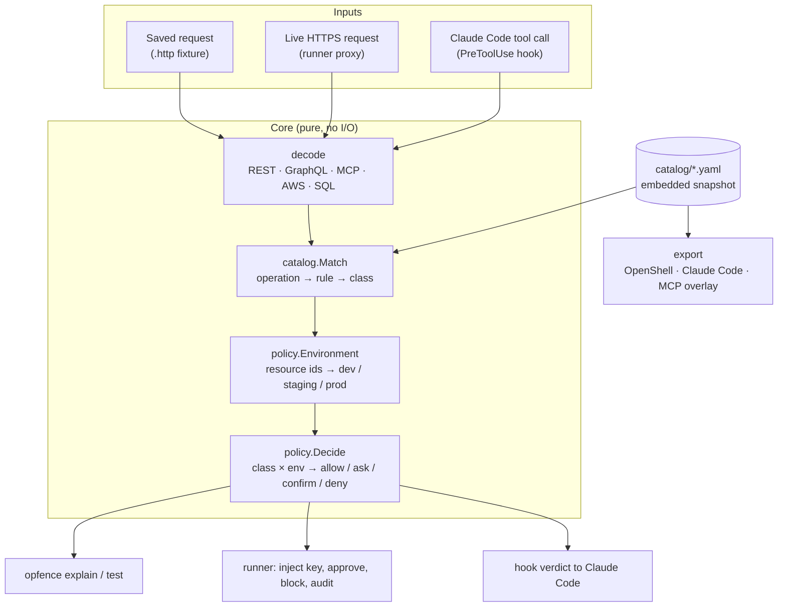
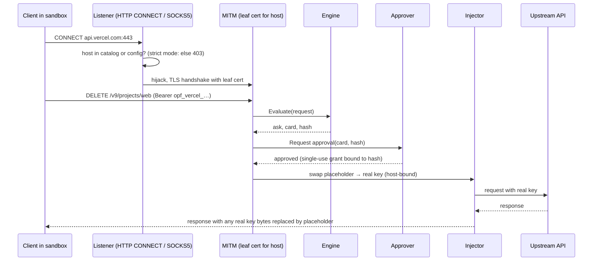

# Opfence architecture and design

16 Oct 2026 · companion to [PLAN.md](PLAN.md) (the why) and [BUILD_PLAN.md](BUILD_PLAN.md) (the order of work)

> This document is the engineering contract. When code and this document disagree, fix one of them in the same change.

## 1. Shape of the system

Opfence is one Go binary with three layers that share one core. The core turns an HTTP request (or an agent tool call) into a list of **operations**, looks each one up in the **catalog** to get a **risk class**, and asks the **policy** what that class means in the target **environment**. Everything else is an adapter around that core.



Design rules that follow from the threat model in PLAN.md:

1. **The core is pure.** `decode`, `catalog` and `policy` do no network, disk or clock access, so they are trivially testable, fuzzable and identical in every adapter.
2. **Fail closed everywhere.** A body that is too large, compressed in an unknown way, unparseable, or a batch we cannot fully expand produces an operation of class `unknown`, never `read`. A hook that crashes exits 2 (Claude Code treats any other non-zero code as "carry on").
3. **The strictest operation wins.** One request can carry many operations (GraphQL root fields, aliases, batches, JSON-RPC batches). Each is decided separately and the request gets the strictest decision; the approval card lists all of them.
4. **Agent text never reaches a decision or a card unlabelled.** Cards are rendered from decoded arguments only.
5. **Few dependencies.** Each dependency is a supply-chain risk in a security tool. Prefer the standard library; every added module needs a reason in this document.

## 2. Packages

```text
cmd/opfence/            main; wires cobra commands to internal packages
internal/classes/       risk classes and decisions, their ordering
internal/request/       Request model, .http fixture parser, body limits, decompression
internal/decode/        Operation model; rest, graphql, mcp, aws, sql decoders
internal/catalog/       rule model, YAML loader, validator, matcher, embedded snapshot
internal/policy/        opfence.yaml model, environment resolver, decision table, merge
internal/engine/        glue: Request → []Evaluation (decode + match + decide)
internal/fixture/       `opfence test`: replay fixtures and compare expectations
internal/export/        openshell, claudecode, mcpannotations
internal/hook/          `opfence hook claude-code`: PreToolUse adapter
internal/proxy/         CONNECT + SOCKS5 listeners, MITM, upstream transport
internal/ca/            per-machine CA, leaf cache, trust install/uninstall
internal/secrets/       store interface, OS keychain backend, placeholders, discovery
internal/inject/        placeholder swap, host binding, SigV4 re-sign, response scrubber
internal/approve/       grants, channels (desktop dialog, control socket), timeouts
internal/audit/         hash-chained JSONL log, verifier
internal/launch/        Claude Code --settings writer, srt wrapper, weak mode, CA env vars
catalog/                provider folders: rules + fixtures (embedded with go:embed)
schema/                 JSON Schema for catalog files and opfence.yaml
docs/
```

`catalog/` is embedded through a tiny package beside the YAML files (`catalog/embed.go`, imported as `catalogdata`) because `go:embed` cannot reach parent directories; `schema/embed.go` does the same for the JSON Schemas. When the catalog moves to its own repository before Launch 1, that package becomes a Go module dependency and nothing else changes.

### Dependencies

| Module | Used by | Why it is worth the risk |
| --- | --- | --- |
| `github.com/spf13/cobra` | CLI | Help, completions and nested commands users expect; one transitive dependency (`pflag`) |
| `go.yaml.in/yaml/v3` | catalog, policy | Maintained fork of `gopkg.in/yaml.v3`; strict decoding (`KnownFields`) catches typos in rules |
| `github.com/vektah/gqlparser/v2` | decode/graphql | Real GraphQL parser; aliases, fragments, variables. Hand-rolled parsing is decoder-evasion risk #11 |
| `github.com/santhosh-tekuri/jsonschema/v6` | tests only | Proves the published JSON Schema accepts every catalog file, so editor validation never drifts from the loader |
| `github.com/zalando/go-keyring` | secrets (stage 7) | macOS Keychain and Linux Secret Service without cgo |
| `github.com/aws/aws-sdk-go-v2` (signer only) | inject (stage 10) | Official SigV4 signer; re-implementing signing is a footgun |

Dropped from the original plan, with reasons:

- **gitleaks as a library:** large transitive tree. Opfence can only inject keys for providers it has rules for, so discovery is catalog-driven (each provider lists its env var names and token prefixes). Generic secret scanning is a different product.
- **cel-go:** no adapter needs arbitrary expressions yet, and exporters cannot translate CEL into OpenShell or Claude Code rules. The catalog uses a small declarative `when` instead (§4.4).
- **charmbracelet/huh:** the agent owns the terminal while `opfence run` is active, so a terminal prompt in the same TTY fights the agent's UI (§9).
- **elazarl/goproxy:** the standard library covers CONNECT, TLS and HTTP/2; owning the code keeps body buffering and fail-closed paths explicit.

## 3. Core model

### 3.1 Risk classes and decisions

```go
type Class string    // read, write, delete, irreversible, money, credential, access, unknown
type Decision int    // Allow < Ask < Confirm < Deny
```

`Confirm` is "ask, and the human must type the resource name". `unknown` is a class, not an error: it is what decoders emit when they cannot be sure, and the default table maps it to `ask`.

Classes have no total order; decisions do. Combining operations combines **decisions**, never classes.

### 3.2 Request

```go
type Request struct {
    Method  string
    Scheme  string            // https unless a fixture says otherwise
    Host    string            // lower-case, no port for 443
    Path    string            // raw path, not unescaped
    Query   url.Values
    Header  http.Header
    Body    []byte            // decompressed, at most MaxBody (64 KiB)
    BodyErr error             // set when the body was too large, truncated or undecodable
}
```

`request.ParseHTTP` reads the `.http` fixture format: an HTTP/1.1 request as it appears on the wire, with an optional leading comment block of `# key: value` metadata (description, captured-on). It is the same text `mitmproxy` exports with "Copy as raw request", so fixtures can be captured from real traffic.

Body handling (shared by fixtures and the proxy):

- `Content-Encoding`: v0 decodes `gzip` and `deflate` (standard library). Brotli would need a dependency, so `br` and any other encoding set `BodyErr` and decoders fail closed.
- Bodies over 64 KiB set `BodyErr`. The proxy still forwards nothing until a decision is made.

### 3.3 Operation

```go
type Operation struct {
    Protocol string            // rest | graphql | mcp | aws | cli
    Host     string
    // REST
    Method, Path string
    // GraphQL
    GraphQLType  string        // query | mutation | subscription
    Field        string        // root field name (not the alias)
    // MCP
    Server, Tool string
    // AWS
    Service, Action string
    // Shared
    Args  map[string]any       // GraphQL args with variables resolved, MCP arguments,
                               // AWS params, REST path params + query params
    Error string               // non-empty means the decoder could not be sure → class unknown
}
```

Decoders return `[]Operation`. A request decodes as:

| Detection | Decoder | Operations |
| --- | --- | --- |
| Host belongs to an `aws` provider and the request is SigV4-signed | `aws` | One per request; service from the credential scope, action from `X-Amz-Target` (JSON protocol) or `Action` (Query protocol); REST-XML services (S3) by method + path rules |
| Body is JSON-RPC 2.0 with `method: tools/call` (single or batch), or host is an MCP provider host | `mcp` | One per `tools/call`; other JSON-RPC methods (`initialize`, `tools/list`) become class `read` via provider defaults |
| Provider declares `graphql` endpoints and the path matches | `graphql` | One per root selection after fragment spreads are inlined; batches (JSON array) expand; persisted-query-only requests become `unknown` |
| Anything else | `rest` | One: method + path, query params as args |

### 3.4 SQL inside tools

`decode/sql` classifies a SQL string for tools like Supabase `execute_sql`. v0 is a tokenizer, not a parser: it strips comments and string literals, splits statements on `;`, and classifies by leading keyword.

| Statement | Class |
| --- | --- |
| `SELECT`, `SHOW`, `EXPLAIN` (without `ANALYZE`), `WITH` whose body has no data-modifying verb | read |
| `INSERT`, `UPDATE … WHERE`, `CREATE`, `ALTER … ADD`, `COMMENT`, `SET` | write |
| `DELETE … WHERE` | delete |
| `DROP`, `TRUNCATE`, `DELETE` or `UPDATE` without `WHERE`, `ALTER … DROP` | irreversible |
| `GRANT`, `REVOKE`, `CREATE/ALTER ROLE`, `CREATE POLICY`, `ALTER … DISABLE ROW LEVEL SECURITY` | access |
| `DO`, `CALL`, `COPY … PROGRAM`, anything unrecognised | unknown |

Multiple statements take the strictest decision. A real Postgres parser replaces this in v1.0 (PLAN.md phase 5).

## 4. Catalog

### 4.1 Layout

```text
catalog/
  railway/
    provider.yaml          provider metadata: hosts, auth, defaults, detection
    volume.yaml            rules (any number of files)
    fixtures/volume-delete.http
  supabase-mcp/
  ...
```

One provider per folder. Rule files and fixtures sit side by side so a contributor's PR touches one folder.

### 4.2 Provider file

```yaml
# catalog/railway/provider.yaml
provider: railway
title: Railway
docs: https://docs.railway.com/integrations/api
hosts: [backboard.railway.com, backboard.railway.app]
graphql: [/graphql/v2]               # paths that carry GraphQL
auth:
  - header: Authorization
    scheme: Bearer
  - header: Project-Access-Token
detect:                               # used by `opfence init` (stage 7)
  env: [RAILWAY_TOKEN, RAILWAY_API_TOKEN]
defaults:                             # classify unlisted operations
  graphql_query: read                 # every GraphQL query is a read on this API
  rest_safe_methods: read             # GET/HEAD/OPTIONS (off unless declared)
```

`defaults` is how the catalog classifies **every** operation without listing thousands of them (review suggestion 1): GraphQL queries and safe HTTP methods are reads on most APIs, and the exceptions (a `GET` that returns a decrypted secret) get explicit rules, which always beat defaults. Anything not covered by a rule or a default is `unknown`.

MCP providers name the servers they describe so both the proxy (by host) and Claude Code (by `mcp__<server>__<tool>`) can find them:

```yaml
provider: supabase-mcp
hosts: [mcp.supabase.com]
mcp:
  names: [supabase]        # common names users give the server in .mcp.json
  package: "@supabase/mcp-server-supabase"
```

### 4.3 Rules

```yaml
# catalog/railway/volume.yaml
operations:
  - id: railway.volume.delete
    match: { graphql: { type: mutation, field: volumeDelete } }
    class: irreversible
    resource: { arg: volumeId, kind: volume }
    card: "Delete Railway volume {volumeId} and all data on it"
    status: verified          # verified | community | draft
    verified: 2026-10-16      # last time a human checked the source
    sources: ["https://github.com/railwayapp/cli/blob/master/src/gql/schema.json"]
    notes: "Railway can restore deleted volumes for 48 h from its dashboard, not via the API"
    tests:
      - fixture: fixtures/volume-delete.http
        expect: irreversible
        resource: vol-pg-data   # optional: the resource value the fixture must yield
```

`status` decides how a rule is used: `verified` and `community` rules drive decisions; `draft` rules are loaded and validated but ignored by the engine and exporters unless the user opts in, because an unreviewed rule could under-classify. `notes` records nuance a reviewer needs (why a class was chosen).

Matchers, exactly one per rule:

| Matcher | Fields | Notes |
| --- | --- | --- |
| `rest` | `method`, `path` | Path template with `{name}` segments (captured into args) and a trailing `{name*}` for the rest of the path. Matching is on the raw path, segment by segment, case-sensitive. Most specific template wins (fewest wildcards, then longest) |
| `graphql` | `type`, `field` | Root field name; aliases are resolved to the field |
| `mcp` | `tool` | Server is the provider |
| `aws` | `service`, `action` | `service` is the SigV4 signing name (`rds`, `s3`, `iam`) |
| `cli` | `command` | Advisory only: used by the Claude Code exporter to write `Bash(<command>:*)` rules, never by the proxy; cannot have request fixtures |

Rule ids are `provider.resource.verb`, globally unique, stable forever (users reference them in overrides; renames keep the old id under `aliases`).

### 4.4 Conditional classes

Some operations are only dangerous with certain arguments: RDS `DeleteDBInstance` with `SkipFinalSnapshot=true` is irreversible, without it a recoverable delete. Supabase `execute_sql` depends on its SQL.

```yaml
  - id: aws.rds.db-instance.delete
    match: { aws: { service: rds, action: DeleteDBInstance } }
    class: delete
    when:
      - if: { arg: SkipFinalSnapshot, equals: "true" }
        class: irreversible
  - id: supabase.sql.execute
    match: { mcp: { tool: execute_sql } }
    class: unknown
    classify: { sql: query }        # derive the class from args.query
```

`when` entries are checked in order; the first that matches wins. Conditions: `equals`, `in`, `present`, `absent`, `matches` (RE2). `classify.sql` hands an argument to the SQL classifier. Exporters that cannot evaluate conditions use the **strictest** class the rule can produce.

### 4.5 Validation

`opfence catalog validate` (and a unit test over the embedded catalog) enforces:

- Strict YAML: unknown keys are errors.
- Ids unique and well-formed; exactly one matcher per rule; known classes; templates parse; `when` regexes compile.
- `status: verified` requires at least one test, at least one source and a `verified` date.
- Every fixture file referenced exists, and every fixture file is referenced by some rule.
- No two rules in a provider can match the same operation with the same specificity (ambiguity is an error, not a silent first-wins). Two providers cannot claim the same host, and a wildcard host cannot overlap another provider's host.
- Every problem is reported at once with `file:line`, so a contributor fixes a rule file in one pass.

`schema/provider.schema.json` and `schema/rules.schema.json` describe the same shapes for editors; a test validates every embedded catalog file against them, and checks that they reject the same mistakes the loader does.

## 5. Policy

### 5.1 Environment resolution

The catalog says *what* an operation is; the environment says *where* it lands. Rules point at a resource argument (`resource.arg`); the user's policy maps resource ids, and other argument values, to environments:

```yaml
# opfence.yaml
version: 1
default_environment: production      # used when nothing matches; fail-safe default
environments:
  production:
    railway:  { environmentId: [e-prod-123], projectId: [p-abc] }
    vercel:   { target: [production], projectId: [prj_web] }
    supabase-mcp: { project_id: [abcd1234] }
  development:
    supabase-mcp: { project_id: [devproj99] }
```

An operation is in environment E if any of its args matches any listed value for its provider under E. Production is checked first, then staging, then development, so an operation that names both a dev and a prod id is production. When nothing matches, `default_environment` applies, and it defaults to `production`. That is noisy on purpose until the user maps their ids, and `opfence explain` says "environment: production (default; map ids in opfence.yaml to change)". The runner's read-only lookups (resolving a Railway volume id to its environment) arrive in stage 9.

### 5.2 Decision table

The defaults from PLAN.md, encoded once in `policy.DefaultTable`:

| Class | development | staging | production |
| --- | --- | --- | --- |
| read | allow | allow | allow |
| write | allow | allow | ask |
| delete | allow | ask | ask |
| irreversible | ask | ask | confirm |
| money | ask | ask | ask |
| credential | ask | ask | deny |
| access | ask | ask | ask |
| unknown | ask | ask | ask |

### 5.3 Overrides and the "repo can only tighten" rule

Two policy files, merged in a fixed way:

| File | Lives in | Written by | May |
| --- | --- | --- | --- |
| `opfence.yaml` | the repository | anyone with commit access, **including the agent** | tighten only |
| `~/.config/opfence/config.yaml` | user config, outside the sandbox's write paths | the human | tighten or loosen |

Both accept `decisions:` (class × environment → decision) and `rules:` (rule id or glob → decision). Merge:

```text
user   = user override for (rule, env) ?? user override for (class, env) ?? DefaultTable
final  = max(user, repo override for (rule, env), repo override for (class, env))
```

So a repository can turn `write` in development into `ask`, but cannot turn `irreversible` into `allow`; a loosening entry in `opfence.yaml` is reported as a warning by `opfence explain` and ignored. Environment *mappings* are a special case: a repo can only move an id towards production (adding an id to `production` is always honoured; adding an id to `development` that the user mapped to production is ignored).

## 6. Engine

```go
type Evaluation struct {
    Op          decode.Operation
    Rule        *catalog.Rule     // nil when unmatched
    Class       classes.Class
    Environment string
    EnvSource   string            // "matched projectId=p-abc" or "default"
    Decision    classes.Decision
    Card        string            // rendered from decoded args only
}
type Result struct {
    Evaluations []Evaluation
    Decision    classes.Decision  // strictest
    Hash        [32]byte          // over canonical (provider, rule, args) of every op; grants bind to it
}
func (e *Engine) Evaluate(r *request.Request) Result
func (e *Engine) EvaluateTool(server, tool string, args map[string]any) Result  // hook path
```

Card templates substitute `{arg}` with the decoded value, truncated to 80 characters and stripped of control characters and Unicode bidi overrides, so a crafted argument cannot fake the card layout.

## 7. Exporters

All exporters read the same catalog and the same policy and write deterministic output (sorted, stable), so diffs in a user's repo are reviewable.

| Target | Output | How classes map |
| --- | --- | --- |
| `openshell` | One network policy per provider: an endpoint for the provider's hosts with `rules` for allowed operations and `deny_rules` for denied ones, GraphQL rules by `operation_type` and `fields`, MCP by `tool`, REST by method and path | OpenShell has allow/deny only: `allow` → rule, `deny` → deny rule, `ask`/`confirm` → left out of the allow-list so OpenShell's own proposal flow asks the human. Exact schema is pinned to the OpenShell docs version checked at stage 5 |
| `claude-code` | A settings fragment: `permissions.deny` and `permissions.ask` entries for MCP tools (`mcp__supabase__delete_branch`) and advisory `Bash(...)` rules from `cli` matchers, plus a `PreToolUse` hook running `opfence hook claude-code` for `mcp__.*` so argument-dependent rules (SQL, environments) are decided live | Static rules use the strictest class per tool and the production column, so they are safe even if the hook is missing; the hook can only make a call stricter than the static rules allow, never looser, because Claude Code applies `deny` rules first |
| `mcp-annotations` | JSON overlay: `{server: {tool: {readOnlyHint, destructiveHint, idempotentHint, openWorldHint, opfenceClass, rule}}}` | read → `readOnlyHint: true`; delete, irreversible → `destructiveHint: true`; others → both false |

The hook (`internal/hook`) reads Claude Code's PreToolUse JSON on stdin, maps `mcp__<server>__<tool>` to a provider through `mcp.names` plus any `servers:` aliases in the user config, evaluates, and prints `hookSpecificOutput` with `permissionDecision` `allow`/`ask`/`deny`. `Confirm` becomes `ask` with the resource name in the reason. Unknown servers produce no output (exit 0) so Opfence does not interfere with tools it knows nothing about; any internal error exits 2 so a broken install blocks instead of silently allowing.

## 8. Runner

### 8.1 Data path



### 8.2 Listeners

Claude Code's docs warn that a sandboxed command can reach **both** the HTTP and the SOCKS proxy ports, and that setting only one leaves the other uncontrolled. Opfence therefore listens on both, on `127.0.0.1` with random ports, and `opfence run` sets both `httpProxyPort` and `socksProxyPort`. Both feed the same connection handler.

Per destination host:

| Host is | Mode `strict` (default) | Mode `open` |
| --- | --- | --- |
| A catalog provider host | intercept | intercept |
| Listed under `passthrough:` in user config (package registries, model APIs) | tunnel without TLS interception | tunnel |
| Anything else | refuse | tunnel, logged |

Intercepted connections are served by `net/http` over the hijacked TLS connection, which negotiates HTTP/2 or HTTP/1.1 by ALPN. HTTP/3 never happens because the proxy only offers TCP. WebSocket upgrades on intercepted hosts are refused in v0.

### 8.3 Certificate authority

- ECDSA P-256 root, 10-year validity, `CN=Opfence local CA (<hostname>)`, generated per machine by `opfence trust`.
- Name constraints: permitted DNS names limited to the hosts of the catalog at generation time, plus user `intercept:` entries. Regenerated (one prompt) when the catalog gains hosts. Clients that ignore name constraints are no worse off than with an unconstrained CA.
- The private key lives in the secret store, never in a file. Leaf certificates are minted in memory, cached per host for their 24 h lifetime.
- `opfence trust` installs the root in the user's trust store (macOS login keychain via `security add-trusted-cert`; Linux: the runtime CA variables, plus distro trust store only with `--system`). `opfence trust --uninstall` reverses every step it took, recorded in a manifest.

### 8.4 Secrets and placeholders

- Real values live in the OS keychain (`go-keyring`), service `opfence`, account `<provider>/<name>`.
- A placeholder is `opf_<provider>_<26 base32 chars>`: random, recognisable in logs, and long enough not to collide with real tokens. The mapping placeholder → (provider, name) is stored in the keychain too.
- The injector replaces placeholders only in the auth locations the provider declares (`auth:`), plus Basic auth passwords, and only when the request's host belongs to that provider. A placeholder sent anywhere else is forwarded unchanged (useless) and logged as a bound-host violation.
- Headless Linux without Secret Service: `opfence` refuses to store secrets and explains how to run a Secret Service (gnome-keyring, KeePassXC). An explicit `--store file` with an age-encrypted file and a passphrase prompt is a later option; it is never chosen silently.

### 8.5 Approvals

The agent owns the terminal during `opfence run`, so approvals never use the agent's TTY.

| Channel | How | Default |
| --- | --- | --- |
| Desktop dialog | macOS `osascript` dialog with Approve / Deny; Linux `zenity` or `kdialog` | on when available |
| Control socket | `opfence approve` in a second terminal lists pending requests and answers them over a 0600 Unix socket | always on |
| Phone (ntfy) | action-button push | v1.0 |

A grant is single-use and bound to the request's `Hash`. `Confirm` requires typing the resource name in the dialog or `opfence approve`. Timeouts (60 s default) deny. A scoped grant ("this rule on this resource for 10 minutes") is opt-in per approval and never available for `credential` or `confirm`.

### 8.6 Audit log

Append-only JSONL at `~/.local/state/opfence/audit.jsonl`. Each line: time, session, host, method, path, rule ids, classes, environment, decision, approver channel, grant hash, upstream status, and `prev` (SHA-256 of the previous line). Bodies and secrets are never written. `opfence log` prints it; `opfence log --verify` checks the chain.

### 8.7 Launcher

`opfence run -- claude [args]`:

1. Starts both listeners and the control socket.
2. Builds a settings JSON and passes it with `claude --settings <json>`, which Claude Code treats as a trusted scope for proxy ports. Nothing in the user's files is modified.
   - `sandbox.enabled: true`, `sandbox.allowUnsandboxedCommands: false`, `sandbox.failIfUnavailable: true`
   - `sandbox.network.httpProxyPort` and `socksProxyPort` → Opfence's listeners
   - `sandbox.filesystem.denyRead`: Opfence's config and state folders
   - `sandbox.credentials` `deny` entries for every env var name Opfence moved to the keychain
   - `sandbox.enableWeakerNetworkIsolation: true` on macOS (Go CLIs and the custom CA)
   - the PreToolUse hook from §7 for MCP tools
3. Sets the CA variables (`SSL_CERT_FILE`, `NODE_EXTRA_CA_CERTS`, `REQUESTS_CA_BUNDLE`, `CURL_CA_BUNDLE`, `GIT_SSL_CAINFO`, `DENO_CERT`, `AWS_CA_BUNDLE`) and the placeholder env vars for the child.
4. Execs the agent as a child, forwards signals, and shuts down when it exits.

Other agents go through Anthropic's `srt` with Opfence as its proxy. With no sandbox, `opfence run --weak` sets `HTTPS_PROXY` only and labels the session weak in every card and log line.

## 9. Testing strategy

| Layer | Tests |
| --- | --- |
| decode, catalog, policy | table tests; Go native fuzzing (`FuzzGraphQL`, `FuzzMCP`, `FuzzHTTPFixture`, `FuzzSQL`) with seeds from fixtures; CI runs each fuzzer for a short budget, nightly for longer |
| catalog content | `opfence test` replays every fixture; CI fails on any miss; a schema test validates every file |
| exporters | golden files; OpenShell output also validated against a vendored copy of its schema |
| hook | stdin/stdout golden tests, including crash → exit 2 |
| proxy, CA, inject, approve | end-to-end tests with `httptest` TLS upstreams, an in-memory keyring and a scripted approver; a PocketOS replay test asserts the upstream is never contacted |
| launcher | settings JSON golden test; a smoke test that `claude --settings` accepts it runs only where Claude Code is installed |

## 10. Decisions made in this document

| Decision | Alternatives | Why |
| --- | --- | --- |
| Catalog classifies every operation via provider `defaults` plus explicit rules | Deny-list of dangerous operations only | Allow-list engines (OpenShell) need to know what is safe, not only what is dangerous (review finding 2) |
| Unresolved environment defaults to production | Default to development | Fail safe; noisy until ids are mapped, and `explain` tells the user how to map them |
| `Confirm` is a separate decision | A flag on `Ask` | Keeps "strictest wins" a plain max over an ordered enum |
| Ambiguous rules are a validation error | First match wins | Silent precedence bugs are how a destructive op gets misclassified |
| Listen on both HTTP and SOCKS ports | HTTP only | Claude Code docs: an unset port stays reachable and uncontrolled |
| Approvals via desktop dialog and a control socket, not the agent's terminal | Terminal prompt as in PLAN.md | The agent's TUI owns the terminal during `opfence run` |
| Catalog-driven secret discovery, no gitleaks | gitleaks library | Only catalogued providers can be injected; far fewer dependencies |
| Hook fails closed (exit 2) | Exit 1 | Claude Code treats exit 1 and timeouts as non-blocking |
| `gzip`/`deflate` only; other encodings fail closed | Add brotli dependency | Clients send compressed request bodies rarely; fail-closed is safe; revisit with data |
