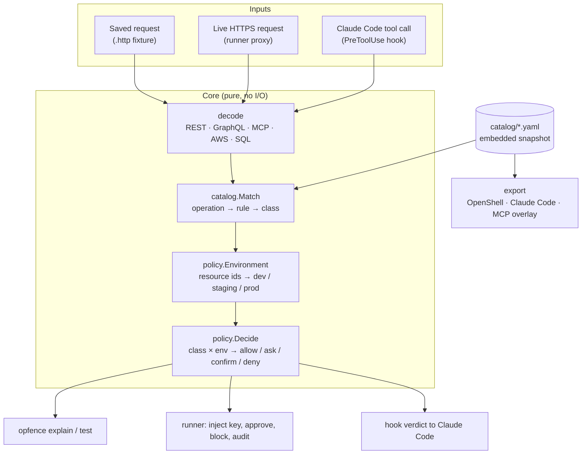
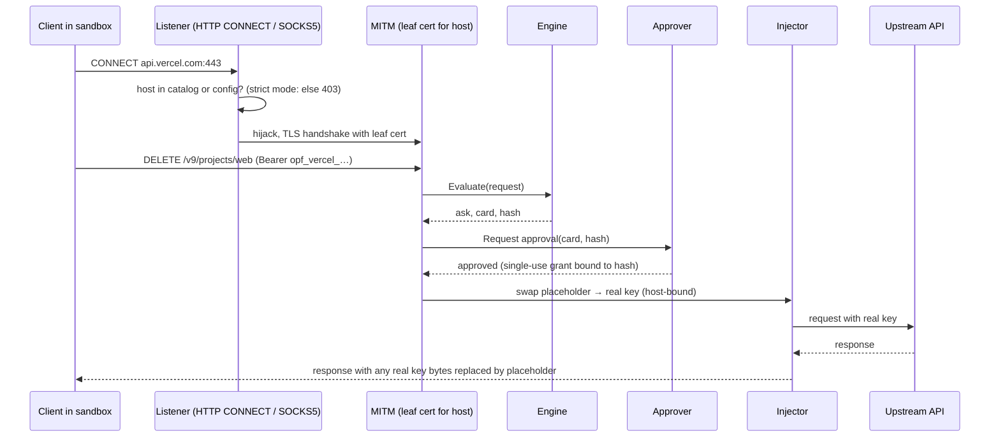

# Opfence architecture and design

16 Oct 2026 · companion to [PLAN.md](PLAN.md) (the why) and [BUILD_PLAN.md](BUILD_PLAN.md) (the order of work)

> This document is the engineering contract. When code and this document disagree, fix one of them in the same change.

## 1. Shape of the system

Opfence is one Go binary with three layers that share one core. The core turns an HTTP request (or an agent tool call) into a list of **operations**, looks each one up in the **catalog** to get a **risk class**, and asks the **policy** what that class means in the target **environment**. Everything else is an adapter around that core.



Design rules that follow from the threat model in PLAN.md:

1. **The core is pure.** `decode`, `catalog` and `policy` do no network, disk or clock access, so they are trivially testable, fuzzable and identical in every adapter.
2. **Fail closed everywhere.** A body that is too large, compressed in an unknown way, unparseable, or a batch we cannot fully expand produces an operation of class `unknown`, never `read`. A hook that crashes exits 2 (Claude Code treats any other non-zero code as "carry on").
3. **The strictest operation wins.** One request can carry many operations (GraphQL root fields, aliases, batches, JSON-RPC batches). Each is decided separately and the request gets the strictest decision; the approval card lists all of them.
4. **Agent text never reaches a decision or a card unlabelled.** Cards are rendered from decoded arguments only.
5. **Few dependencies.** Each dependency is a supply-chain risk in a security tool. Prefer the standard library; every added module needs a reason in this document.

## 2. Packages

```text
cmd/opfence/            main; wires cobra commands to internal packages
internal/classes/       risk classes and decisions, their ordering
internal/request/       Request model, .http fixture parser, body limits, decompression
internal/decode/        Operation model; rest, graphql, mcp, aws, sql decoders
internal/catalog/       rule model, YAML loader, validator, matcher, embedded snapshot
internal/policy/        opfence.yaml model, environment resolver, decision table, merge
internal/engine/        glue: Request → []Evaluation (decode + match + decide)
internal/fixture/       `opfence test`: replay fixtures and compare expectations
internal/export/        openshell, claudecode, mcpannotations
internal/hook/          `opfence hook claude-code`: PreToolUse adapter
internal/proxy/         CONNECT + SOCKS5 listeners, MITM, upstream transport
internal/ca/            per-machine CA, leaf cache, trust install/uninstall
internal/secrets/       store interface, OS keychain backend, placeholders, discovery
internal/inject/        placeholder swap, host binding, SigV4 re-sign, response scrubber
internal/approve/       grants, channels (desktop dialog, control socket), timeouts
internal/audit/         hash-chained JSONL log, verifier
internal/launch/        Claude Code --settings writer, srt wrapper, weak mode, CA env vars
catalog/                provider folders: rules + fixtures (embedded with go:embed)
schema/                 JSON Schema for catalog files and opfence.yaml
docs/
```

`catalog/` is embedded through a tiny package beside the YAML files (`catalog/embed.go`, imported as `catalogdata`) because `go:embed` cannot reach parent directories; `schema/embed.go` does the same for the JSON Schemas. When the catalog moves to its own repository before Launch 1, that package becomes a Go module dependency and nothing else changes.

### Dependencies

| Module | Used by | Why it is worth the risk |
| --- | --- | --- |
| `github.com/spf13/cobra` | CLI | Help, completions and nested commands users expect; one transitive dependency (`pflag`) |
| `go.yaml.in/yaml/v3` | catalog, policy | Maintained fork of `gopkg.in/yaml.v3`; strict decoding (`KnownFields`) catches typos in rules |
| `github.com/vektah/gqlparser/v2` | decode/graphql | Real GraphQL parser; aliases, fragments, variables. Hand-rolled parsing is decoder-evasion risk #11 |
| `github.com/santhosh-tekuri/jsonschema/v6` | tests only | Proves the published JSON Schema accepts every catalog file, so editor validation never drifts from the loader |
| `github.com/zalando/go-keyring` | secrets | macOS Keychain and Linux Secret Service without cgo; brings `godbus/dbus` and `golang.org/x/sys`. Checked on 16 Oct 2026 that v0.2.8 passes values to `security` on stdin, not in process arguments |
| `github.com/aws/aws-sdk-go-v2` (signer only) | inject (stage 10) | Official SigV4 signer; re-implementing signing is a footgun |

Dropped from the original plan, with reasons:

- **gitleaks as a library:** large transitive tree. Opfence can only inject keys for providers it has rules for, so discovery is catalog-driven (each provider lists its env var names and token prefixes). Generic secret scanning is a different product.
- **cel-go:** no adapter needs arbitrary expressions yet, and exporters cannot translate CEL into OpenShell or Claude Code rules. The catalog uses a small declarative `when` instead (§4.4).
- **charmbracelet/huh:** the agent owns the terminal while `opfence run` is active, so a terminal prompt in the same TTY fights the agent's UI (§9).
- **elazarl/goproxy:** the standard library covers CONNECT, TLS and HTTP/2; owning the code keeps body buffering and fail-closed paths explicit.

## 3. Core model

### 3.1 Risk classes and decisions

```go
type Class string    // read, write, delete, irreversible, money, credential, access, unknown
type Decision int    // Allow < Ask < Confirm < Deny
```

`Confirm` is "ask, and the human must type the resource name". `unknown` is a class, not an error: it is what decoders emit when they cannot be sure, and the default table maps it to `ask`.

Classes have no total order; decisions do. Combining operations combines **decisions**, never classes.

### 3.2 Request

```go
type Request struct {
    Method  string
    Scheme  string            // https unless a fixture says otherwise
    Host    string            // lower-case, no port for 443
    Path    string            // raw path, not unescaped
    Query   url.Values
    Header  http.Header
    Body    []byte            // decompressed, at most MaxBody (64 KiB)
    BodyErr error             // set when the body was too large, truncated or undecodable
}
```

`request.ParseHTTP` reads the `.http` fixture format: an HTTP/1.1 request as it appears on the wire, with an optional leading comment block of `# key: value` metadata (description, captured-on). It is the same text `mitmproxy` exports with "Copy as raw request", so fixtures can be captured from real traffic.

Body handling (shared by fixtures and the proxy):

- `Content-Encoding`: v0 decodes `gzip` and `deflate` (standard library). Brotli would need a dependency, so `br` and any other encoding set `BodyErr` and decoders fail closed.
- Bodies over 64 KiB set `BodyErr`. The proxy still forwards nothing until a decision is made.

### 3.3 Operation

```go
type Operation struct {
    Protocol string            // rest | graphql | mcp | aws | cli
    Host     string
    // REST
    Method, Path string
    // GraphQL
    GraphQLType  string        // query | mutation | subscription
    Field        string        // root field name (not the alias)
    // MCP
    Server, Tool string
    // AWS
    Service, Action string
    // Shared
    Args  map[string]any       // GraphQL args with variables resolved, MCP arguments,
                               // AWS params, REST path params + query params
    Error string               // non-empty means the decoder could not be sure → class unknown
}
```

Decoders return `[]Operation`. A request decodes as:

| Detection | Decoder | Operations |
| --- | --- | --- |
| Provider has `sigv4: true` | `aws` | One per request. Service from the SigV4 (or SigV4A) credential scope. S3 is resolved from method, bucket (virtual-hosted or path-style), key and sub-resource (`?delete`, `?policy`, …) and never from an `Action` parameter or `X-Amz-Target`, which S3 ignores. Other services: JSON protocol only on `POST /` with `X-Amz-Target`; Query protocol only on `/` for services known to speak it, with exactly one `Action`; anything else is a REST call (Lambda, API Gateway) matched by `aws: {service, method, path}`. Unsigned requests fail closed |
| Provider has an `mcp` block | `mcp` | One per JSON-RPC message (batches expand). `tools/call` carries the tool and its arguments; other methods keep their name, and the engine treats the known housekeeping methods (`initialize`, `tools/list`, `ping`, …) as reads. `GET`/`DELETE` (stream, session end) carry no tool call |
| Path matches the provider's `graphql` paths (after normalisation) | `graphql` | One per root field of **every** operation in the document, not only the one `operationName` selects; fragment spreads and inline fragments are flattened; aliases resolve to the field; variables (and their defaults) are substituted into args; batches expand; `@skip`/`@include` are ignored (a field that might run counts as running). Persisted queries without text, parse errors, multipart uploads and more than 200 operations fail closed |
| Anything else | `rest` | One: method and raw path. Args are namespaced: `query.<name>`, `body.<field>` (JSON or form bodies) and, added by the matcher, path parameters at the top level. `X-HTTP-Method-Override` and its variants replace the method, since some servers honour them. An unreadable body sets `BodyErr`; rules whose conditions read `body.*` then classify as unknown |

JSON bodies are parsed with a strict reader that rejects duplicate keys anywhere (`{"query":"safe","query":"mutation …"}` would otherwise be read differently by Opfence and by servers that keep the first value), trailing data and nesting deeper than 64 levels. Numbers stay as `json.Number`; GraphQL literals are converted to the same Go types, so conditions behave the same for both.

Path normalisation (`request.NormalizePath`) collapses `//`, drops `.` and trailing slashes, and resolves `..` the way servers route, so an agent cannot dodge a rule with `/v9//projects/x/`. Percent-encoded slashes stay inside their segment.

### 3.4 SQL inside tools

`decode/sql` classifies a SQL string for tools like Supabase `execute_sql`. v0 is a tokenizer, not a parser: it strips comments and string literals, splits statements on `;`, and classifies by leading keyword.

| Statement | Class |
| --- | --- |
| `SELECT`, `SHOW`, `EXPLAIN` (without `ANALYZE`), `WITH` whose body has no data-modifying verb | read |
| `INSERT`, `UPDATE … WHERE`, `CREATE`, `ALTER … ADD`, `COMMENT`, `SET` | write |
| `DELETE … WHERE` | delete |
| `DROP`, `TRUNCATE`, `DELETE` or `UPDATE` without `WHERE`, `ALTER … DROP` | irreversible |
| `GRANT`, `REVOKE`, `CREATE/ALTER ROLE`, `CREATE POLICY`, `ALTER … DISABLE ROW LEVEL SECURITY` | access |
| `DO`, `CALL`, `COPY … PROGRAM`, anything unrecognised | unknown |

Multiple statements take the strictest decision. A real Postgres parser replaces this in v1.0 (PLAN.md phase 5).

## 4. Catalog

### 4.1 Layout

```text
catalog/
  railway/
    provider.yaml          provider metadata: hosts, auth, defaults, detection
    volume.yaml            rules (any number of files)
    fixtures/volume-delete.http
  supabase-mcp/
  ...
```

One provider per folder. Rule files and fixtures sit side by side so a contributor's PR touches one folder.

### 4.2 Provider file

```yaml
# catalog/railway/provider.yaml
provider: railway
title: Railway
docs: https://docs.railway.com/integrations/api
hosts: [backboard.railway.com, backboard.railway.app]
graphql: [/graphql/v2]               # paths that carry GraphQL
auth:
  - header: Authorization
    scheme: Bearer
  - header: Project-Access-Token
detect:                               # used by `opfence init` (stage 7)
  env: [RAILWAY_TOKEN, RAILWAY_API_TOKEN]
defaults:                             # classify unlisted operations
  graphql_query: read                 # every GraphQL query is a read on this API
  rest_safe_methods: read             # GET/HEAD/OPTIONS (off unless declared)
  # aws_read_actions: read            # sigv4 providers: Describe*, Get*, List*, Head*, BatchGet*, Scan, Query
```

`defaults` is how the catalog classifies **every** operation without listing thousands of them (review suggestion 1): GraphQL queries and safe HTTP methods are reads on most APIs, and the exceptions (a `GET` that returns a decrypted secret) get explicit rules, which always beat defaults. Anything not covered by a rule or a default is `unknown`.

MCP providers name the servers they describe so both the proxy (by host) and Claude Code (by `mcp__<server>__<tool>`) can find them:

```yaml
provider: supabase-mcp
hosts: [mcp.supabase.com]
mcp:
  names: [supabase]        # common names users give the server in .mcp.json
  package: "@supabase/mcp-server-supabase"
```

### 4.3 Rules

```yaml
# catalog/railway/volume.yaml
operations:
  - id: railway.volume.delete
    match: { graphql: { type: mutation, field: volumeDelete } }
    class: irreversible
    resource: { arg: volumeId, kind: volume }
    card: "Delete Railway volume {volumeId} and all data on it"
    status: verified          # verified | community | draft
    verified: 2026-10-16      # last time a human checked the source
    sources: ["https://github.com/railwayapp/cli/blob/master/src/gql/schema.json"]
    notes: "Railway can restore deleted volumes for 48 h from its dashboard, not via the API"
    tests:
      - fixture: fixtures/volume-delete.http
        expect: irreversible
        resource: vol-pg-data   # optional: the resource value the fixture must yield
```

`status` decides how a rule is used: `verified` and `community` rules drive decisions; `draft` rules are loaded and validated but ignored by the engine and exporters unless the user opts in, because an unreviewed rule could under-classify. `notes` records nuance a reviewer needs (why a class was chosen).

Matchers, exactly one per rule:

| Matcher | Fields | Notes |
| --- | --- | --- |
| `rest` | `method`, `path` | Path template with `{name}` segments (captured into args) and a trailing `{name*}` for the rest of the path. Matching is on the raw path, segment by segment, case-sensitive. Most specific template wins (fewest wildcards, then longest) |
| `graphql` | `type`, `field` | Root field name; aliases are resolved to the field |
| `mcp` | `tool` | Server is the provider |
| `aws` | `service` plus either `action`, or `method` and `path` | `service` is the SigV4 signing name (`rds`, `s3`, `iam`). `action` for Query/JSON services and S3; `method` + `path` template for REST-JSON services such as Lambda |
| `cli` | `command` | Advisory only: used by the Claude Code exporter to write `Bash(<command>:*)` rules, never by the proxy; cannot have request fixtures |

Rule ids are `provider.resource.verb`, globally unique, stable forever (users reference them in overrides; renames keep the old id under `aliases`).

### 4.4 Conditional classes

Some operations are only dangerous with certain arguments: RDS `DeleteDBInstance` with `SkipFinalSnapshot=true` is irreversible, without it a recoverable delete. Supabase `execute_sql` depends on its SQL.

```yaml
  - id: aws.rds.db-instance.delete
    match: { aws: { service: rds, action: DeleteDBInstance } }
    class: delete
    when:
      - if: { arg: SkipFinalSnapshot, equals: "true" }
        class: irreversible
  - id: supabase.sql.execute
    match: { mcp: { tool: execute_sql } }
    class: unknown
    classify: { sql: query }        # derive the class from args.query
```

Every `when` entry whose condition holds adds its class (so entry order can never hide a stricter class); the rule's own `class` applies only when none holds. An operation with several classes gets the strictest decision among them, as SQL does. Conditions: `equals`, `in`, `present`, `absent`, `matches` (RE2). `classify.sql` hands an argument to the SQL classifier. Exporters that cannot evaluate conditions use the **strictest** class the rule can produce.

### 4.5 Classification conventions

The catalog applies the same judgement everywhere, so a reviewer can check a rule against a rule, not against taste:

- **When the API hides the state that decides the class, assume the worse case.** S3 `DeleteObject` is `irreversible` because Opfence cannot see whether the bucket is versioned; DynamoDB `BatchWriteItem` is `delete` because a batch can carry deletes.
- **Reading a secret value is `credential`, wherever it hides.** Lambda `GetFunction` and `ListFunctions` return environment variables, Railway's `variables` query returns values, SSM `GetParameter` with `WithDecryption` returns plain text. Listing metadata about secrets stays `read`.
- **Setting a value in a store meant for secrets is `credential`; setting a generic variable is `write`.** GitHub Actions secrets, Secrets Manager values, SSM `SecureString` and Vercel `encrypted`/`sensitive` variables are secrets. Railway variables and Vercel `plain` variables are not marked as secrets, so setting one is a write (it reveals nothing); deleting any variable is `irreversible` because no API keeps the old value.
- **Deleting a secret is `irreversible`.** No provider returns a secret's value, so it cannot be put back.
- **Running arbitrary commands is `irreversible`.** SSM `SendCommand` and `StartSession` can do anything the machine can.
- **Exposing something to the internet is `access`.** A public domain or TCP proxy for a Railway service, a public function URL, a public ACL, a public gist.
- **`delete` means it can be restored or rebuilt** (a deployment from its commit, a branch from any clone, a scheduled project deletion that can be cancelled); **`irreversible` means the data is gone** (volumes, backups, snapshots, tables, environments with their secrets).
- **Turning off a safety net is as dangerous as what it protects**: RDS `BackupRetentionPeriod=0` deletes existing automated backups and DynamoDB disabling point-in-time recovery discards the window, so both are `irreversible`.
- **Old API versions match too.** Vercel keeps serving older versions of an endpoint, so its rules use a `{version}` first segment.

### 4.6 Validation

`opfence catalog validate` (and a unit test over the embedded catalog) enforces:

- Strict YAML: unknown keys are errors.
- Ids unique and well-formed; exactly one matcher per rule; known classes; templates parse; `when` regexes compile.
- `status: verified` requires at least one test, at least one source and a `verified` date.
- Every fixture file referenced exists, and every fixture file is referenced by some rule.
- No two rules in a provider can match the same operation with the same specificity (ambiguity is an error, not a silent first-wins). Two providers cannot claim the same host, and a wildcard host cannot overlap another provider's host.
- Every problem is reported at once with `file:line`, so a contributor fixes a rule file in one pass.

`schema/provider.schema.json` and `schema/rules.schema.json` describe the same shapes for editors; a test validates every embedded catalog file against them, and checks that they reject the same mistakes the loader does.

## 5. Policy

### 5.1 Environment resolution

The catalog says *what* an operation is; the environment says *where* it lands. Rules point at a resource argument (`resource.arg`); the user's policy maps resource ids, and other argument values, to environments:

```yaml
# opfence.yaml
version: 1
default_environment: production      # used when nothing matches; fail-safe default
environments:
  production:
    railway:  { environmentId: [e-prod-123], projectId: [p-abc] }
    vercel:   { target: [production], projectId: [prj_web] }
    supabase-mcp: { project_id: [abcd1234] }
  development:
    supabase-mcp: { project_id: [devproj99] }
```

An operation is in environment E if any of its args matches any listed value for its provider under E. Production is checked first, then staging, then development, so an operation that names both a dev and a prod id is production. When nothing matches, `default_environment` applies, and it defaults to `production`. That is noisy on purpose until the user maps their ids, and `opfence explain` says "environment: production (default; map ids in opfence.yaml to change)". The runner's read-only lookups (resolving a Railway volume id to its environment) arrive in stage 9.

### 5.2 Decision table

The defaults from PLAN.md, encoded once in `policy.DefaultTable`:

| Class | development | staging | production |
| --- | --- | --- | --- |
| read | allow | allow | allow |
| write | allow | allow | ask |
| delete | allow | ask | ask |
| irreversible | ask | ask | confirm |
| money | ask | ask | ask |
| credential | ask | ask | deny |
| access | ask | ask | ask |
| unknown | ask | ask | ask |

### 5.3 Overrides and the "repo can only tighten" rule

Two policy files, merged in a fixed way:

| File | Lives in | Written by | May |
| --- | --- | --- | --- |
| `opfence.yaml` | the repository | anyone with commit access, **including the agent** | tighten only |
| `~/.config/opfence/config.yaml` | user config, outside the sandbox's write paths | the human | tighten or loosen |

Both accept `decisions:` (class × environment → decision) and `rules:` (rule id or glob → decision). Merge:

```text
user   = user override for (rule, env) ?? user override for (class, env) ?? DefaultTable
final  = max(user, repo override for (rule, env), repo override for (class, env))
```

So a repository can turn `write` in development into `ask`, but cannot turn `irreversible` into `allow`; a loosening entry in `opfence.yaml` is reported as a warning by `opfence explain` and `opfence policy check` and ignored. The same holds for every other setting: a repository may set a stricter `default_environment`, `mode: strict` and a shorter approval timeout, never the reverse.

Environment *mappings* follow the same rule: a repository mapping is honoured only when it makes the result stricter than the user's mappings and the default would. With the default `default_environment: production`, a repository can mark ids as production but cannot mark anything as development. Teams that keep their id mappings in the repository and accept that the agent can edit them set `trust_repo: true` in the user config, which treats `opfence.yaml` as user config; it is off by default and documented as weaker.

Settings only the user config may hold: `include_draft` (use draft rules), `trust_repo`, and `servers` (MCP server name → catalog provider, for servers a user named differently).

Conditions in rules compare case-insensitively (`SkipFinalSnapshot=True` still matches `equals: "true"`); an explicit `null` counts as present, because in a PATCH body it usually clears a setting (`"ssoProtection": null` turns Vercel deployment protection off). When the argument is a list (a repeated query parameter, or a path that runs through a list such as `input.refUpdates.force`), a condition holds if it holds for any element, so `?decrypt=false&decrypt=true` cannot hide the second value. Rules therefore use `when` only to make a class stricter.

## 6. Engine

```go
type Evaluation struct {
    Op          decode.Operation
    Rule        *catalog.Rule     // nil when unmatched
    Class       classes.Class
    Environment string
    EnvSource   string            // "matched projectId=p-abc" or "default"
    Decision    classes.Decision
    Card        string            // rendered from decoded args only
}
type Result struct {
    Evaluations []Evaluation
    Decision    classes.Decision  // strictest
    Hash        [32]byte          // over canonical (provider, rule, args) of every op; grants bind to it
}
func (e *Engine) Evaluate(r *request.Request) Result
func (e *Engine) EvaluateTool(p *catalog.Provider, tool string, args map[string]any) Result  // hook path
```

Card templates substitute `{arg}` with the decoded value, truncated to 80 characters and stripped of control characters, line breaks, zero-width characters and Unicode bidi overrides, so a crafted argument cannot fake the card layout. Operations with no rule get a generic card ("Vercel POST api.vercel.com/v9/projects").

`Hash` covers the host, each operation's provider, rule, protocol fields and arguments, and the exact request body bytes, so a grant for one body can never cover another sent to the same operation.

Unmatched operations are classified by provider defaults (`DefaultClass`): GraphQL queries, safe REST methods and AWS read actions where the provider declares them, MCP housekeeping messages as `read`, everything else `unknown`. An operation the decoder could not read never matches a rule.

## 7. Exporters

All exporters read the same catalog and the same policy and write deterministic output (sorted, stable), so diffs in a user's repo are reviewable. Exports are static: they cannot see a call's arguments. Two helpers in `internal/export` turn a rule's possible classes (its own class, each `when` class, and the SQL classes for `classify: sql`) into one static decision:

- `Ceiling(rule, env)`: the strictest decision the rule can get in one environment. Used where the export must never allow something the engine would stop (OpenShell).
- `Floor(rule)`: the most lenient decision the rule can get in any environment. Used where a static rule must never be stricter than the live answer (Claude Code permission rules).

| Target | Output | How decisions map |
| --- | --- | --- |
| `openshell` | One network policy per provider, for one `--environment` (default production), as YAML with explanatory comments. GraphQL endpoints match `operation_type` and `fields`, REST endpoints `method` and a path glob, MCP endpoints JSON-RPC `method` and `tool` | OpenShell has allow and deny only. Ceiling `allow` → allow rule, `deny` → deny rule, `ask`/`confirm` → left out of the allow-list, so OpenShell blocks it and its proposal flow can ask a human. All endpoints use `enforcement: enforce` |
| `claude-code` | A settings fragment: a `PreToolUse` hook (`matcher: "^mcp__"`, `onFailure: "block"`) running `opfence hook claude-code`, plus `permissions.deny` and `permissions.ask` for MCP tools under every server name (`mcp__supabase__delete_branch`) and `Bash(<command> *)` rules from `cli` matchers | Floor `deny` → deny rule, floor `ask`/`confirm` → ask rule, floor `allow` → nothing. The hook decides everything else live |
| `mcp-annotations` | JSON: `{server: {tool: {readOnlyHint, destructiveHint, idempotentHint, opfenceClasses, rule}}}` | `readOnlyHint` only when every possible class is read; `destructiveHint` when any possible class is delete or irreversible; `idempotentHint` always false, since the catalog does not record it |

**Why Claude Code static rules use the floor.** Claude Code applies `deny` and `ask` permission rules whatever a hook returns (rules are checked deny, then ask, then allow; a hook's `allow` does not bypass them). A static `ask` on `execute_sql` would prompt even for a `SELECT` the hook allows, and a production-only `deny` would block a development call. So the static rules hold only what is true for every argument in every environment: they keep the always-dangerous tools gated if the hook is ever removed, and never contradict it. In the shipped catalog that is the money tools; everything argument- or environment-dependent is the hook's job.

**OpenShell carve-outs.** A provider default can allow broad traffic: every GraphQL query, or `GET`/`HEAD`/`OPTIONS` on `/**` when `rest_safe_methods` is read. An operation that Opfence would only *ask* about but that such an allow rule (or an overlapping allow glob from another rule, checked by `globsOverlap`) would let through is written as a deny rule with a comment naming the rule that would have covered it. A rule whose class depends on arguments is denied outright when any argument could make it denied (for example `vercel.env.list`, credential with `decrypt=true`), with a comment, because OpenShell does not check those arguments. The export is therefore never looser than the engine and sometimes stricter; `opfence run` is the precise path.

**What OpenShell does not get.** AWS (`sigv4: true` providers) is not exported: Query and JSON actions travel in the body or the `X-Amz-Target` header, which OpenShell's REST matchers cannot see. The output's footer says so. The schema was checked against the OpenShell policy schema reference on 2026-10-16 (`OpenShellSchemaChecked`); tests decode every export into strict structs that reject unknown fields, check that `access` and `rules` are never combined and that no key starts with `_provider_`, and model OpenShell's matching to prove no exported allow covers an operation the engine would stop.

**The hook.** `internal/hook` reads Claude Code's PreToolUse JSON on stdin (capped at 4 MiB, numbers kept exact), maps `mcp__<server>__<tool>` to a provider through the user's `servers:` aliases, then the catalog's `mcp.names`, then the `claude_ai_<name>` (claude.ai connector) and `plugin_<plugin>_<name>` (plugin) forms, and evaluates with the repository's `opfence.yaml` from the `cwd` Claude Code reports. It prints `hookSpecificOutput` with `permissionDecision` `allow`/`ask`/`deny`; `confirm` becomes `ask` with "check that <resource> is the one you mean" in the reason. Other tools, other events and unknown servers produce no output (exit 0), so Opfence does not interfere with tools it knows nothing about; an unknown tool on a known server is `unknown` and asks. Any error (bad JSON, an alias to a missing provider, a broken policy file) exits 2, and the exported settings add `onFailure: "block"` so a crash or timeout also blocks instead of silently allowing.

`opfence policy check` cross-checks the policy against the catalog and warns about rule overrides that match no rule, and environment mappings or server aliases naming providers the catalog does not have, since each would otherwise do nothing silently.

## 8. Runner

### 8.1 Data path



### 8.2 Listeners

Claude Code's docs warn that a sandboxed command can reach **both** the HTTP and the SOCKS proxy ports, and that setting only one leaves the other uncontrolled. Opfence therefore listens on both, on loopback only (`opfence proxy` refuses any other address, because the proxy acts with the user's authority), and `opfence run` sets both `httpProxyPort` and `socksProxyPort`. Both front ends feed the same routing code (`internal/proxy`).

Per destination host:

| Host is | Mode `strict` (default) | Mode `open` |
| --- | --- | --- |
| A catalog provider host, port 443 | intercept | intercept |
| A catalog provider host, any other port, or plain HTTP | refuse (Opfence only inspects HTTPS on 443) | refuse |
| On the passthrough list | tunnel without TLS interception | tunnel |
| Anything else | refuse | tunnel, logged |

The passthrough list is a built-in set of package registries and source hosts (`policy.DefaultPassthrough`: npm, PyPI, Go proxy, crates.io, RubyGems, Maven Central, github.com and its download hosts), so installs work in strict mode, plus the user config's `passthrough:` (exact names or `*.suffix`). Only the user config may add hosts; a repository may set `passthrough_defaults: false` to drop the built-in set, never turn it back on. github.com is on the list until git ref decoding lands (stage 10), so `git push` is not inspected before then.

Routing rules that close tunnel tricks:

- For TLS on 443 to a catalog host or to an IP address, the proxy reads the ClientHello first (with crypto/tls's own parser, then replays the bytes). A server name that differs from the CONNECT host is refused, so a tunnel cannot be opened under one name and used for another. A tunnel to an IP is decided by its server name and then dials that *name*, so the name that was allowed is the one reached.
- Inside an intercepted connection, a request whose `Host` differs from the TLS server name gets `421 Misdirected Request` (HTTP/2 clients then open a new connection, which gets its own decision).
- What a passthrough tunnel carries is not visible: a client could send a different `Host` header inside the encrypted session (domain fronting). Requiring a matching server name stops the SNI form; the `Host` form gains nothing once stage 7 keeps real keys out of the agent's reach. Tunnels on ports other than 443 are not inspected at all.
- Upstream dials refuse loopback, private, link-local, CGNAT and other non-public addresses after DNS resolution, in every mode, so the proxy cannot become a way around the sandbox to local services or cloud metadata (`169.254.169.254`). A host the user lists by exact name under `passthrough:` (an internal registry) is exempt.

Intercepted connections are served by one `net/http` server, which negotiates HTTP/2 or HTTP/1.1 by ALPN; upstream requests go out over HTTP/2 where the server offers it. HTTP/3 never happens because the proxy only offers TCP. WebSocket and other `Upgrade` requests on intercepted hosts are blocked in v0. The first 64 KiB of a body is read for the decision and the whole body is then forwarded unchanged; larger bodies cannot be inspected and are decided as `unknown`. The forwarded path and query are byte-for-byte the ones that were evaluated (a path that cannot be forwarded unchanged is blocked). Responses stream without buffering, so MCP's server-sent events work.

A request that is not forwarded gets a `403` with a JSON body naming the card, class, environment, rule and reason. A single MCP JSON-RPC request gets a JSON-RPC error instead (`code -32001`, with the same message), because agents show that to the model as the tool's result, so the agent learns why and can tell the user. `ask` and `confirm` go to an `Approver`; until stage 8 the only one is `NoApprover`, which blocks with "Opfence needs a human to approve this, and no approval channel is running."

### 8.3 Certificate authority

- ECDSA P-256 root, 10-year validity, `CN=Opfence local CA (<hostname>)`.
- Name constraints (critical): permitted DNS names limited to the hosts of the catalog at generation time (`*.amazonaws.com` becomes `amazonaws.com`), so a leaked key cannot impersonate other sites to clients that enforce constraints (Go, OpenSSL, macOS do). Creating an unconstrained CA is an error. A catalog host the CA does not cover is refused with a message to regenerate it, not served with a certificate that would fail.
- Leaf certificates: one P-256 key per CA instance, a certificate per host valid 24 h, cached in memory (renewed in the last hour, the cache capped at 1024 hosts).
- Stage 6: `opfence proxy` generates a CA per run and writes only its certificate (`ca.pem`) to the state folder; the key never leaves memory. Stage 7 stores one long-lived root in the OS keychain (`ca.Load` / `KeyPEM`), and `opfence trust` (stage 9) installs it: macOS login keychain via `security add-trusted-cert`; Linux: the runtime CA variables, plus the distro trust store only with `--system`. `opfence trust --uninstall` reverses every step it took, recorded in a manifest. A per-run CA is not enough on its own because Go programs on macOS verify through the system trust store and ignore `SSL_CERT_FILE`.

### 8.4 Secrets and placeholders

- Real values live in the OS keychain (`go-keyring`), service `opfence`: one item per secret (account `secret/<provider>/<name>`, holding provider, name, value, placeholder and the files it came from), an `index` item because keychains cannot list, and a `ca` item with the CA's certificate and key.
- **Placeholders keep the token's shape.** A placeholder has the real value's length, its known prefix (`ghp_`, `sbp_`, `github_pat_`, or a generic `abc_`), its alphabet (hex stays hex) and its punctuation positions, with every other character random. A JSON Web Token keeps its (non-secret) header and payload and gets a random signature. This replaces the earlier `opf_<provider>_<random>` design for two reasons found while building: clients that check a token's format (the Supabase CLI insists on `sbp_` plus 40 hex characters) keep working, and swapping a value for its placeholder never changes a body's length, so the scrubber never has to rewrite `Content-Length`. Only the alphabet and punctuation carry over, never which character class sits at which position, so a placeholder reveals nothing about the secret part of the value. Values shorter than 16 characters are not held: they are not API tokens, and scrubbing them would hit ordinary text.
- **Injection** (`internal/inject`) happens after the decision, so the engine and the request hash never see real values. A placeholder is swapped in only in the auth locations the provider declares (`auth:` header with its scheme, query parameter, or Basic auth), and only for that provider's own secrets. A placeholder for another provider is forwarded unchanged (the API rejects it) and the audit entry says so; the audit entry names the secrets injected, never their values.
- **Scrubbing.** When Opfence holds any secret, every intercepted response has every known secret value replaced by its placeholder, in headers and in the streamed body (values split across reads included). That covers a provider echoing a token, and one provider returning another's key (`vercel env pull` returning a Railway token). To make bodies readable the proxy removes the client's `Accept-Encoding`, so Go's transport asks for gzip and decodes it; a response in any other encoding is refused with `502`. Values that come back URL-encoded or base64-encoded are not recognised.
- **`opfence init`** reads `.env` files anywhere in the repository (not `.env.example` and other templates; not `node_modules`, `vendor` and similar), `.claude/settings*.json` and the MCP config files, and recognises credentials by each provider's `detect.env` names and token prefixes, and by the auth header of a remote MCP server whose URL is a catalog host. It skips references (`${VAR}`), values with escape sequences, short values, existing placeholders and AWS keys (until SigV4 re-signing, stage 10). It stores each value and reads it back before changing any file, then rewrites files atomically, keeping their mode and every other byte. The same value found twice gets one placeholder. `opfence init --undo` writes the real values back; `opfence secrets list | rm` manage the items (`rm` refuses while a file still holds the placeholder).
- **Keys in MCP server configs stay in place for now.** The agent starts MCP servers outside its sandbox, and both they and remote MCP connections reach their APIs without the Opfence proxy (a local Supabase MCP server calls `api.supabase.com`, which is not even in the catalog). A placeholder there would break the server, so `init` reports these keys and leaves them; the PreToolUse hook still decides every tool call. Routing MCP traffic through the proxy is stage 9's job, after which `init` can move these keys too.
- After `init`, anything that reads those `.env` files needs the proxy to get real keys, including the user's own dev server. `opfence run -- <command>` (stage 9) sets the proxy and CA variables for any command, including `NODE_USE_ENV_PROXY=1` for Node's built-in `fetch`.
- The CA key is kept in the keychain item `ca` and reused while it covers every catalog host; otherwise a new CA is made (and must be trusted again). Without a keychain, the proxy runs with a per-run CA and no injection, and says so.
- **Keychain exposure.** On macOS, go-keyring creates items through `/usr/bin/security` (passing values on stdin, never in arguments), so any process running as the user that can run `security` can read them without a prompt. On Linux, any process that can reach the session D-Bus can read Secret Service items. The sandbox is therefore what keeps the agent away from the keychain: stage 9's launcher denies the sandbox access to the D-Bus socket on Linux, and `opfence doctor` checks from inside the sandbox that the items cannot be read. If that check fails on macOS, a cgo Keychain backend with an ACL bound to the Opfence binary replaces go-keyring behind the same `Store` interface.
- Headless Linux without Secret Service: `opfence` refuses to store secrets and explains how to run a Secret Service (gnome-keyring, KeePassXC). An explicit `--store file` with an age-encrypted file and a passphrase prompt is a later option; it is never chosen silently.

### 8.5 Approvals

The agent owns the terminal during `opfence run`, so approvals never use the agent's TTY.

| Channel | How | Default |
| --- | --- | --- |
| Desktop dialog | macOS `osascript` dialog with Approve / Deny; Linux `zenity` or `kdialog` | on when available |
| Control socket | `opfence approve` in a second terminal lists pending requests and answers them over a 0600 Unix socket | always on |
| Phone (ntfy) | action-button push | v1.0 |

A grant is single-use and bound to the request's `Hash`. `Confirm` requires typing the resource name in the dialog or `opfence approve`. Timeouts (60 s default) deny. A scoped grant ("this rule on this resource for 10 minutes") is opt-in per approval and never available for `credential` or `confirm`.

### 8.6 Audit log

Append-only JSONL at `$XDG_STATE_HOME/opfence/audit.jsonl` (default `~/.local/state/opfence/audit.jsonl`), file `0600` in a `0700` folder. Each line: time, session, event (`request`, `tunnel`, `refused`), host, port, method, path **without the query string** (queries can carry tokens), one item per operation (rule, class, environment, decision, card), overall decision, outcome (`forwarded`, `approved`, `blocked`, `tunneled`, `refused`, `error`), reason, approver channel, request hash for approvals, upstream status, and `prev`: the SHA-256 of the previous line, empty for the first. Bodies, headers and secrets are never written.

A forwarded request is logged when the upstream's response headers arrive, before any body streams, so a long stream is logged at once. An advisory file lock (`flock`) keeps the chain intact when several Opfence processes share the file. A failed write is reported on stderr and does not stop traffic; the next successful line still chains to the last one on disk.

`opfence log` prints the last entries; `opfence log --verify` checks the chain and exits 1 at the first line that does not follow its predecessor, which catches edited, inserted, reordered and deleted lines, including deletions at the start. Lines cut from the end cannot be detected from the file alone; anchoring the latest hash elsewhere is a later option.

### 8.7 Launcher

`opfence run -- claude [args]`:

1. Starts both listeners and the control socket.
2. Builds a settings JSON and passes it with `claude --settings <json>`, which Claude Code treats as a trusted scope for proxy ports. Nothing in the user's files is modified.
   - `sandbox.enabled: true`, `sandbox.allowUnsandboxedCommands: false`, `sandbox.failIfUnavailable: true`
   - `sandbox.network.httpProxyPort` and `socksProxyPort` → Opfence's listeners
   - `sandbox.filesystem.denyRead`: Opfence's config and state folders
   - `sandbox.credentials` `deny` entries for every env var name Opfence moved to the keychain
   - `sandbox.enableWeakerNetworkIsolation: true` on macOS (Go CLIs and the custom CA)
   - the PreToolUse hook from §7 for MCP tools
3. Sets the CA variables (`SSL_CERT_FILE`, `NODE_EXTRA_CA_CERTS`, `REQUESTS_CA_BUNDLE`, `CURL_CA_BUNDLE`, `GIT_SSL_CAINFO`, `DENO_CERT`, `AWS_CA_BUNDLE`) and the placeholder env vars for the child.
4. Execs the agent as a child, forwards signals, and shuts down when it exits.

Other agents go through Anthropic's `srt` with Opfence as its proxy. With no sandbox, `opfence run --weak` sets `HTTPS_PROXY` only and labels the session weak in every card and log line.

## 9. Testing strategy

| Layer | Tests |
| --- | --- |
| decode, catalog, policy | table tests; Go native fuzzing (`FuzzGraphQL`, `FuzzMCP`, `FuzzHTTPFixture`, `FuzzSQL`) with seeds from fixtures; CI runs each fuzzer for a short budget, nightly for longer |
| catalog content | `opfence test` replays every fixture; CI fails on any miss; a schema test validates every file |
| exporters | golden files for every target and environment; OpenShell output decoded into strict schema structs and checked by a model of OpenShell matching (never looser than the engine) |
| hook | decision tests over the embedded catalog (SQL, aliases, plugin and claude.ai names, unknown servers and tools), bad input → error; CLI test that errors exit 2 |
| proxy, CA, inject, approve | end-to-end tests with `httptest` TLS upstreams (HTTP/2 and HTTP/1.1, CONNECT and SOCKS5), an in-memory keyring and a scripted approver; a PocketOS replay test asserts the upstream is never contacted; tunnel tricks (server name mismatch, IP tunnels, Host mismatch, private addresses) each have a test |
| launcher | settings JSON golden test; a smoke test that `claude --settings` accepts it runs only where Claude Code is installed |

## 10. Decisions made in this document

| Decision | Alternatives | Why |
| --- | --- | --- |
| Catalog classifies every operation via provider `defaults` plus explicit rules | Deny-list of dangerous operations only | Allow-list engines (OpenShell) need to know what is safe, not only what is dangerous (review finding 2) |
| Unresolved environment defaults to production | Default to development | Fail safe; noisy until ids are mapped, and `explain` tells the user how to map them |
| `Confirm` is a separate decision | A flag on `Ask` | Keeps "strictest wins" a plain max over an ordered enum |
| Ambiguous rules are a validation error | First match wins | Silent precedence bugs are how a destructive op gets misclassified |
| Listen on both HTTP and SOCKS ports | HTTP only | Claude Code docs: an unset port stays reachable and uncontrolled |
| Approvals via desktop dialog and a control socket, not the agent's terminal | Terminal prompt as in PLAN.md | The agent's TUI owns the terminal during `opfence run` |
| Catalog-driven secret discovery, no gitleaks | gitleaks library | Only catalogued providers can be injected; far fewer dependencies |
| Hook fails closed (exit 2, `onFailure: "block"`) | Exit 1 | Claude Code treats other exit codes and timeouts as non-blocking unless the hook sets `onFailure: "block"` |
| Claude Code static rules use the floor decision | Strictest class, production column | Claude Code applies ask/deny rules over a hook's allow, so a stricter static rule would prompt for every safe call |
| OpenShell export denies ask-class operations a broad allow would cover | Leave them to the broad allow | An export must never be looser than the engine |
| AWS is not exported to OpenShell | Export by path | The action is in the body or a header OpenShell cannot match |
| Proxy refuses non-public upstream addresses in every mode | Trust the sandbox's own rules | The proxy runs outside the sandbox; without this, open mode (or a DNS name pointing at 127.0.0.1) would reach local services and cloud metadata |
| Built-in passthrough list of package registries | Strict means only catalog hosts | Installs must work in strict mode or users switch to open mode, which is weaker; the list is public registries only and can be turned off |
| Blocked MCP calls answer with a JSON-RPC error | HTTP 403 for everything | Agents show a JSON-RPC error to the model, so it can explain the block to the user instead of retrying blindly |
| Audit write failures are logged, not fatal | Stop all traffic | A full disk should not take the agent down; the chain stays verifiable |
| Stage 6 CA lives for one run | Persist the key in a file | Keys never touch disk; from stage 7 the root is kept in the keychain |
| Placeholders keep the token's length, prefix and alphabet | `opf_<provider>_<random>` | Format-checking clients keep working, and scrubbing never changes lengths |
| `init` leaves keys in MCP configs in place until stage 9 | Move them too | MCP servers do not use the proxy yet, so a placeholder would break them; the hook still gates their calls |
| Responses are refused when Opfence cannot decode them and holds secrets | Pass them through | An undecodable body could carry a real key back to the agent |
| `gzip`/`deflate` only; other encodings fail closed | Add brotli dependency | Clients send compressed request bodies rarely; fail-closed is safe; revisit with data |
