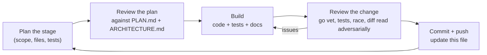
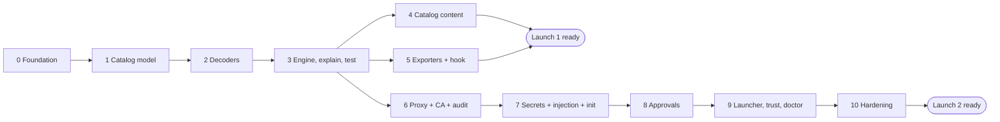

# Opfence build plan

16 Oct 2026 · how the work in [PLAN.md](PLAN.md) gets built, stage by stage. Design detail is in [ARCHITECTURE.md](ARCHITECTURE.md).

## How each stage runs

Every stage goes through the same loop, and the stage table below is updated as each one closes.

A stage is done only when: `go build ./...`, `go vet ./...` and `go test -race ./...` pass; new code has tests; ARCHITECTURE.md matches what was built; and the stage's exit criteria below are met.

Work lands on the branch `claude/opfence-build-u92kub` with one pull request into `main`; each stage is one or more commits on it.

## Review of PLAN.md (16 Oct 2026)

The plan is sound: the catalog-first order, the threat model and the two-launch strategy hold up. The review found gaps that would have caused rework later. Each is resolved in ARCHITECTURE.md; the owner delegated these calls ("choose what is best for the product").

| # | Gap in PLAN.md | Resolution | Where |
| --- | --- | --- | --- |
| 1 | Review suggestion 1 (classify every operation, not only dangerous ones) was still pending | Adopted. Provider `defaults` classify unlisted GraphQL queries and safe HTTP methods; explicit rules override; everything else is `unknown` | ARCHITECTURE §4.2 |
| 2 | Approvals are shown as a terminal prompt, but during `opfence run -- claude` the agent's TUI owns the terminal | Desktop dialog plus `opfence approve` over a control socket; terminal prompt dropped | §8.5 |
| 3 | Claude Code docs: a sandboxed command can use **both** proxy ports, and setting only `httpProxyPort` leaves SOCKS uncontrolled | Runner listens on both and sets both ports | §8.2 |
| 4 | Claude Code treats hook exit 1, crashes and timeouts as "carry on" | Hook exits 2 on any internal error | §7 |
| 5 | "Repository policy can only tighten" had no merge rule | Defined: `final = max(user-effective, repo)`, also for environment mappings | §5.3 |
| 6 | Unmapped environment was undefined (a Railway `volumeDelete` carries only a volume id) | Defaults to production; `explain` says how to map ids; runner lookups later | §5.1 |
| 7 | Some operations are dangerous only with certain arguments (RDS final snapshot, `execute_sql`) | Declarative `when` conditions and `classify: {sql: arg}`; exporters use the strictest outcome | §4.4 |
| 8 | gitleaks as a dependency is heavy, and only catalogued providers can be injected anyway | Catalog-driven discovery (`detect.env`, token prefixes) | §2 |
| 9 | A per-session proxy token cannot be passed through Claude Code's `httpProxyPort` | Dropped; placeholders are random per install and host-bound, listener is localhost-only | §8.4 |
| 10 | Force-push detection over git smart HTTP needs the object graph, which a proxy does not have | Ref deletion and pushes to configured protected branches are detectable; plain force-push is documented as a gap, covered by GitHub branch protection | stage 10 |
| 11 | `opfence run` modifying the user's Claude Code settings files is fragile and leaves residue | Pass everything with `claude --settings <json>`, a trusted scope for proxy ports and credentials | §8.7 |
| 12 | Phase 0 (interviews, maintainer outreach) can't be done by Claude | Drafts in [docs/outreach/](outreach/); the owner sends them. Building does not wait on them | stage 0 |

Not changed: Go; Apache-2.0; OpenShell, Claude Code and MCP annotation exporters for Launch 1; Agent Vault dropped; runner replaces Claude Code's proxy; one repository until Launch 1.

## Stages

| # | Stage | Delivers | Exit criteria | Status |
| --- | --- | --- | --- | --- |
| 0 | Foundation | Go module, CLI skeleton (`opfence version`), Makefile, CI (build, vet, test, race, lint), LICENSE, README, SECURITY.md, CONTRIBUTING.md, outreach drafts | CI green on the PR | done |
| 1 | Catalog model | `classes`, `catalog` types, strict YAML loader, validator, JSON Schema, embedded catalog, `opfence catalog validate` and `catalog list` | Validator rejects every invalid case in its table tests; schema test passes | done |
| 2 | Decoders | `request` (fixture parser, body limits, gzip/deflate), `decode` rest, graphql, mcp, aws, sql; fuzz targets | Decoder tests incl. aliases, fragments, batches, variables, JSON-RPC batches, AWS JSON + Query; fuzzers run clean for 60 s each | planned |
| 3 | Engine, explain, test | `catalog.Match`, `policy` (opfence.yaml, environments, table, merge), `engine`, `opfence explain <file.http>`, `opfence test` | PocketOS fixture explains as irreversible/confirm in production; tighten-only merge tests; `opfence test` fails on a deliberately broken rule | planned |
| 4 | Catalog content | 60+ rules across Railway, Vercel, Supabase MCP, GitHub, AWS, each from a primary source and with a fixture | `opfence test` passes; every `verified` rule has a source and date | planned |
| 5 | Exporters + hook | `opfence export --target openshell / claude-code / mcp-annotations`; `opfence hook claude-code` | Golden tests; hook tests incl. fail-closed; OpenShell output matches its published schema | planned |
| 6 | Proxy + CA + audit | CA generation, leaf cache, HTTP CONNECT + SOCKS5 listeners, MITM with HTTP/1.1 + HTTP/2, strict/open modes, enforcement (deny/allow; ask = deny until stage 8), audit log with hash chain, `opfence proxy`, `opfence log` | End-to-end test: PocketOS request blocked and upstream never contacted; allowed request reaches a TLS upstream; `log --verify` detects tampering | planned |
| 7 | Secrets + injection + init | Store interface + keychain backend, placeholders, host-bound injector, response scrubber, `opfence init` (catalog-driven discovery in `.env` and MCP configs), `opfence secrets list/rm` | Placeholder never injected to a foreign host; scrubber removes echoed keys; init rewrites a sample repo correctly | planned |
| 8 | Approvals | Grants bound to request hash, timeouts, desktop dialog channel, control socket + `opfence approve`, confirm-by-typing, scoped grants | Grant for A can't be replayed for B; timeout denies; confirm requires the resource name | planned |
| 9 | Launcher, trust, doctor | `opfence run -- claude` (settings via `--settings`), srt wrapper, weak mode, `opfence trust` / `--uninstall`, `opfence doctor`, CA env vars | Settings golden test; doctor reports each check; trust manifest reverses cleanly | planned |
| 10 | Hardening | SigV4 re-signing, git smart-HTTP ref decoding, longer fuzzing, GoReleaser config, docs ("What this does not protect against") | No known high-severity issues; release dry-run builds macOS and Linux binaries | planned |

Stages 4 and 5 can interleave; stage 6 does not depend on 4 or 5. The order above front-loads Launch 1 (catalog + exporters), matching PLAN.md's roadmap.

### What each stage review checks

- **Plan review:** does the stage serve a user story in PLAN.md; does it contradict ARCHITECTURE.md; is anything in it speculative (cut it); are tests named before code.
- **Change review:** `gofmt`, `go vet`, `go test -race`; fail-closed paths covered by tests; no agent-controlled text reaches a decision or card unlabelled; no secret written to disk or logs; new dependencies justified in ARCHITECTURE.md §2; docs updated.

## Stage log

Each closed stage gets a short entry: what shipped, what changed from the plan, and follow-ups.

**Stage 0 · Foundation (done 16 Oct 2026).** Go module, cobra CLI with `opfence version`, Makefile (`check`, `lint`, `fuzz`), CI on Linux and macOS, licence and project docs, outreach drafts. Changed from plan: minimum Go is 1.26, because Go 1.27 is current and 1.25 no longer gets security fixes.

**Stage 1 · Catalog model (done 16 Oct 2026).** `internal/classes`, `internal/catalog` (types, strict loader, validator with 40 table-tested failure cases, REST path templates with normalisation), JSON Schemas with a test that keeps them in step with the loader, the embedded catalog, and `opfence catalog validate | list | providers` with a global `--catalog DIR`. The first real rule, `railway.volume.delete`, is checked against Railway's public GraphQL schema (the mutation exists and takes `volumeId`), which settles the open question in PLAN.md's review notes. Added beyond plan: `notes` on rules, wildcard host overlap checks, and the rule that `draft` rules don't drive decisions.
