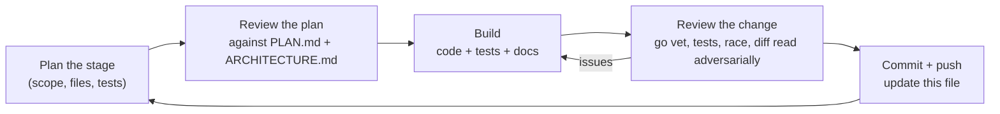
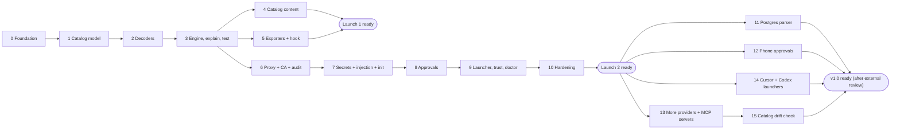

# Opfence build plan

16 Oct 2026 · how the work in [PLAN.md](PLAN.md) gets built, stage by stage. Design detail is in [ARCHITECTURE.md](ARCHITECTURE.md).

## How each stage runs

Every stage goes through the same loop, and the stage table below is updated as each one closes.

A stage is done only when: `go build ./...`, `go vet ./...` and `go test -race ./...` pass; new code has tests; ARCHITECTURE.md matches what was built; and the stage's exit criteria below are met.

Work lands on the branch `claude/opfence-build-u92kub` with one pull request into `main`; each stage is one or more commits on it.

## Review of PLAN.md (16 Oct 2026)

The plan is sound: the catalog-first order, the threat model and the two-launch strategy hold up. The review found gaps that would have caused rework later. Each is resolved in ARCHITECTURE.md; the owner delegated these calls ("choose what is best for the product").

| # | Gap in PLAN.md | Resolution | Where |
| --- | --- | --- | --- |
| 1 | Review suggestion 1 (classify every operation, not only dangerous ones) was still pending | Adopted. Provider `defaults` classify unlisted GraphQL queries and safe HTTP methods; explicit rules override; everything else is `unknown` | ARCHITECTURE §4.2 |
| 2 | Approvals are shown as a terminal prompt, but during `opfence run -- claude` the agent's TUI owns the terminal | Desktop dialog plus `opfence approve` over a control socket; terminal prompt dropped | §8.5 |
| 3 | Claude Code docs: a sandboxed command can use **both** proxy ports, and setting only `httpProxyPort` leaves SOCKS uncontrolled | Runner listens on both and sets both ports | §8.2 |
| 4 | Claude Code treats hook exit 1, crashes and timeouts as "carry on" | Hook exits 2 on any internal error | §7 |
| 5 | "Repository policy can only tighten" had no merge rule | Defined: `final = max(user-effective, repo)`, also for environment mappings | §5.3 |
| 6 | Unmapped environment was undefined (a Railway `volumeDelete` carries only a volume id) | Defaults to production; `explain` says how to map ids; runner lookups later | §5.1 |
| 7 | Some operations are dangerous only with certain arguments (RDS final snapshot, `execute_sql`) | Declarative `when` conditions and `classify: {sql: arg}`; exporters use the strictest outcome | §4.4 |
| 8 | gitleaks as a dependency is heavy, and only catalogued providers can be injected anyway | Catalog-driven discovery (`detect.env`, token prefixes) | §2 |
| 9 | A per-session proxy token cannot be passed through Claude Code's `httpProxyPort` | Dropped; placeholders are random per install and host-bound, listener is localhost-only | §8.4 |
| 10 | Force-push detection over git smart HTTP needs the object graph, which a proxy does not have | Ref deletion and pushes to configured protected branches are detectable; plain force-push is documented as a gap, covered by GitHub branch protection | stage 10 |
| 11 | `opfence run` modifying the user's Claude Code settings files is fragile and leaves residue | Pass everything with `claude --settings <json>`, a trusted scope for proxy ports and credentials | §8.7 |
| 12 | Phase 0 (interviews, maintainer outreach) can't be done by Claude | Drafts in [docs/outreach/](outreach/); the owner sends them. Building does not wait on them | stage 0 |

Not changed: Go; Apache-2.0; OpenShell, Claude Code and MCP annotation exporters for Launch 1; Agent Vault dropped; runner replaces Claude Code's proxy; one repository until Launch 1.

## Stages

| # | Stage | Delivers | Exit criteria | Status |
| --- | --- | --- | --- | --- |
| 0 | Foundation | Go module, CLI skeleton (`opfence version`), Makefile, CI (build, vet, test, race, lint), LICENSE, README, SECURITY.md, CONTRIBUTING.md, outreach drafts | CI green on the PR | done |
| 1 | Catalog model | `classes`, `catalog` types, strict YAML loader, validator, JSON Schema, embedded catalog, `opfence catalog validate` and `catalog list` | Validator rejects every invalid case in its table tests; schema test passes | done |
| 2 | Decoders | `request` (fixture parser, body limits, gzip/deflate), `decode` rest, graphql, mcp, aws, sql; fuzz targets | Decoder tests incl. aliases, fragments, batches, variables, JSON-RPC batches, AWS JSON + Query; fuzzers run clean for 60 s each | done |
| 3 | Engine, explain, test | `catalog.Match`, `policy` (opfence.yaml, environments, table, merge), `engine`, `opfence explain <file.http>`, `opfence test` | PocketOS fixture explains as irreversible/confirm in production; tighten-only merge tests; `opfence test` fails on a deliberately broken rule | done |
| 4 | Catalog content | 60+ rules across Railway, Vercel, Supabase MCP, GitHub, AWS, each from a primary source and with a fixture | `opfence test` passes; every `verified` rule has a source and date | done (445 rules) |
| 5 | Exporters + hook | `opfence export --target openshell / claude-code / mcp-annotations`; `opfence hook claude-code` | Golden tests; hook tests incl. fail-closed; OpenShell output matches its published schema | done |
| 6 | Proxy + CA + audit | CA generation, leaf cache, HTTP CONNECT + SOCKS5 listeners, MITM with HTTP/1.1 + HTTP/2, strict/open modes, enforcement (deny/allow; ask = deny until stage 8), audit log with hash chain, `opfence proxy`, `opfence log` | End-to-end test: PocketOS request blocked and upstream never contacted; allowed request reaches a TLS upstream; `log --verify` detects tampering | done |
| 7 | Secrets + injection + init | Store interface + keychain backend, placeholders, host-bound injector, response scrubber, `opfence init` (catalog-driven discovery in `.env` and MCP configs), `opfence secrets list/rm` | Placeholder never injected to a foreign host; scrubber removes echoed keys; init rewrites a sample repo correctly | done |
| 8 | Approvals | Grants bound to request hash, timeouts, desktop dialog channel, control socket + `opfence approve`, confirm-by-typing, scoped grants | Grant for A can't be replayed for B; timeout denies; confirm requires the resource name | done |
| 9 | Launcher, trust, doctor | `opfence run -- claude` (settings via `--settings`), srt wrapper, weak mode, `opfence trust` / `--uninstall`, `opfence doctor`, CA env vars | Settings golden test; doctor reports each check; trust manifest reverses cleanly | done |
| 10 | Hardening | SigV4 re-signing, git smart-HTTP ref decoding, longer fuzzing, GoReleaser config, docs ("What this does not protect against") | No known high-severity issues; release dry-run builds macOS and Linux binaries | done |
| 11 | Postgres parser | `decode.ClassifySQL` on a real Postgres grammar instead of the keyword tokenizer | Every tokenizer case keeps its class or gets a stricter, correct one; cases the tokenizer got wrong are fixed; unparsable SQL and unhandled statement types are unknown; the hook starts in milliseconds; fuzzer clean | done |
| 12 | Phone approvals | ntfy channel: push with Approve / Deny action buttons, answers verified before they count | An answer for request A cannot approve B; a forged or replayed answer is refused; confirm still needs the typed name; works with ntfy.sh and a self-hosted server | planned |
| 13 | More providers and MCP servers | Catalog to 15 providers and 25 MCP servers, each rule checked against the provider's own schema | Every rule has a fixture; `opfence test` green; source check passes | planned |
| 14 | Cursor and Codex | `opfence run --srt` presets for Cursor's CLI agent and Codex CLI, their MCP configs in `init` | Each starts behind the proxy in srt with keys as placeholders; doctor probe passes inside | planned |
| 15 | Catalog drift check | `opfence catalog check-sources` compares rules with providers' published schemas; nightly job | A renamed or removed operation fails the job | planned |

v1.0 also needs an external security review of the proxy and approver (PLAN.md phase 5), which the owner arranges, and the catalog split into its own repository, which needs the owner's GitHub account.

Stages 4 and 5 can interleave; stage 6 does not depend on 4 or 5. The order above front-loads Launch 1 (catalog + exporters), matching PLAN.md's roadmap.

### What each stage review checks

- **Plan review:** does the stage serve a user story in PLAN.md; does it contradict ARCHITECTURE.md; is anything in it speculative (cut it); are tests named before code.
- **Change review:** `gofmt`, `go vet`, `go test -race`; fail-closed paths covered by tests; no agent-controlled text reaches a decision or card unlabelled; no secret written to disk or logs; new dependencies justified in ARCHITECTURE.md §2; docs updated.

## Stage log

Each closed stage gets a short entry: what shipped, what changed from the plan, and follow-ups.

**Stage 0 · Foundation (done 16 Oct 2026).** Go module, cobra CLI with `opfence version`, Makefile (`check`, `lint`, `fuzz`), CI on Linux and macOS, licence and project docs, outreach drafts. Changed from plan: minimum Go is 1.26, because Go 1.27 is current and 1.25 no longer gets security fixes.

**Stage 1 · Catalog model (done 16 Oct 2026).** `internal/classes`, `internal/catalog` (types, strict loader, validator with 40 table-tested failure cases, REST path templates with normalisation), JSON Schemas with a test that keeps them in step with the loader, the embedded catalog, and `opfence catalog validate | list | providers` with a global `--catalog DIR`. The first real rule, `railway.volume.delete`, is checked against Railway's public GraphQL schema (the mutation exists and takes `volumeId`), which settles the open question in PLAN.md's review notes. Added beyond plan: `notes` on rules, wildcard host overlap checks, and the rule that `draft` rules don't drive decisions.

**Stage 2 · Decoders (done 16 Oct 2026).** `internal/request` (fixture parser, live-request reader, gzip/deflate with a decompressed-size cap, path normalisation) and `internal/decode` (REST, GraphQL via gqlparser, MCP JSON-RPC, AWS SigV4 with an S3 resolver, SQL tokenizer-classifier). Four fuzz targets ran 60 s each; the fixture fuzzer found one bug (an empty host from `A://.`), fixed and kept as a regression seed. The change review found and fixed a real bypass: an agent could add `?Action=ListBuckets` or `X-Amz-Target` to an S3 or Lambda delete, which those services ignore, to make it look like a read. S3 is now resolved only from method, bucket, key and sub-resource; JSON protocol only counts on `POST /`; Query protocol only on `/` for known Query services. Also added from review: method-override headers, duplicate-key rejection in JSON, and evaluating every GraphQL operation in a document. The catalog gained `aws: {service, method, path}` matchers and an `aws_read_actions` default.

**Stage 3 · Engine, explain, test (done 16 Oct 2026).** Catalog matching (host lookup with wildcards, REST specificity with a positional tie-break, GraphQL, MCP, AWS action and method+path), provider defaults, `when` conditions and SQL classification; `internal/policy` (strict `opfence.yaml` and user config, the default table, tighten-only merge for decisions, rule overrides, environment mappings and every other setting); `internal/engine` (evaluations, strictest decision, sanitised cards, a hash bound to operations and body bytes); `internal/fixture`; and the commands `opfence explain [--json]`, `opfence test` and `opfence policy check`, with global `--policy` and `--user-config`. The PocketOS replay explains as `irreversible`, production by default, `CONFIRM`. Added beyond plan: `trust_repo` for teams that want repository id mappings honoured, and case-insensitive condition matching after the review noticed `SkipFinalSnapshot=True` would have slipped past `equals: "true"`.

**Stage 4 · Catalog content (done 16 Oct 2026).** 445 verified rules with 496 fixtures: Railway 72 (GraphQL), Vercel 70 (REST), Supabase MCP 33 (every tool the server ships), GitHub 134 (REST and GraphQL) and AWS 136 (RDS, S3, EC2, IAM, STS, CloudFormation, Secrets Manager, SSM, KMS, DynamoDB, Lambda, Route 53). Every rule was written against the provider's own machine-readable source (Railway's introspection dump in its CLI, the OpenAPI spec the Vercel SDK is built from, the Supabase MCP tool definitions, GitHub's OpenAPI description and GraphQL schema, botocore's service models), and a script checked each operation, path, method and argument name against that source before any fixture was written; it caught wrong argument names and a Route 53 URI parameter. The judgement calls are written down as conventions in ARCHITECTURE.md §4.5. The rule review changed the engine in four places: a condition now holds if any element of a list matches (a repeated `?decrypt=false&decrypt=true` used to slip past `equals: "true"`); an explicit `null` counts as present (`"ssoProtection": null` turns Vercel protection off and was being classified as a plain write); every matching `when` entry adds its class instead of only the first, so entry order can't hide a stricter class; and Query-protocol list parameters (`InstanceId.1`, `Tags.member.1.Key`) decode into lists that rules and cards can name. Vercel rules match any version prefix, because older versions of an endpoint keep working. Follow-ups: record the Vercel and Railway CLIs' real traffic once the proxy exists (stage 6), to catch undocumented endpoints that return secrets behind a `GET`; turn the source check into a Go command (`opfence catalog check-sources`) for the nightly drift job in PLAN.md.

**Stage 5 · Exporters and hook (done 16 Oct 2026). Launch 1 ready.** `internal/export` (OpenShell network policies per environment, a Claude Code settings fragment, MCP tool annotations), `internal/hook` (the Claude Code PreToolUse hook for MCP tools), and the commands `opfence export --target openshell | claude-code | mcp-annotations` and `opfence hook claude-code`. Formats were checked against the current OpenShell schema reference and Claude Code hook and permission docs on 16 Oct 2026. Changed from the plan after checking those docs: Claude Code applies ask and deny rules over a hook's allow, so the static rules now hold only each tool's floor decision (what it gets for every argument in every environment) instead of the strictest production class, which would have prompted for every `SELECT`; the hook is installed with `onFailure: "block"` because Claude Code otherwise lets a crashed or timed-out hook through. The review of the OpenShell output found that a broad default allow (every GraphQL query, `GET /**`) or an overlapping allow glob would let through operations Opfence only asks about, so those are now written as deny rules with a comment saying why; argument-dependent rules that can be denied are denied outright, also with a comment. AWS is not exported to OpenShell (the action is in the body or a header). Added beyond plan: `opfence policy check` warns about rule overrides, mappings and aliases that match nothing in the catalog, after a test showed a typo'd rule id silently did nothing. Follow-ups: OpenShell has no ask, so its export is stricter than the engine for argument-dependent rules; `opfence run` (stages 6 to 9) is the precise path.

**Stage 6 · Proxy, CA and audit log (done 16 Oct 2026).** `internal/ca` (name-constrained P-256 root, cached 24 h leaves), `internal/proxy` (HTTP CONNECT and SOCKS5 front ends sharing one router, TLS interception for catalog hosts served by one HTTP/2-capable server, streaming forwarding, an `Approver` interface with a deny-all default), `internal/audit` (hash-chained JSONL with a file lock and a verifier), and the commands `opfence proxy` and `opfence log [--verify]`. The PocketOS replay is blocked over HTTP/2, HTTP/1.1 and SOCKS5 with the upstream never contacted; an allowed query reaches a TLS upstream with its path, query, body and auth header unchanged and proxy headers stripped; a real `curl` run gets the 403 card. The change review closed four ways around the proxy, each now with a test: a passthrough tunnel carrying TLS for an API host (on a shared CDN that reaches the API uninspected), so every 443 tunnel must be TLS with a matching server name; a tunnel to an IP address, now decided and dialled by its server name; a request whose `Host` differs from the TLS name (now `421`); and tunnels to loopback, private or metadata addresses, refused after DNS resolution in every mode. A fuzz target found that SOCKS accepted an empty host name, now rejected. Added beyond plan: blocked MCP calls answer with a JSON-RPC error the model can read; a built-in passthrough list of package registries so strict mode stays usable (`passthrough_defaults: false` turns it off; only the user config can add hosts); the audit log omits query strings. Changed from plan: the CA lives for one run and only its certificate is written to disk, until the keychain arrives in stage 7. Known gaps, documented in ARCHITECTURE.md §8.2: `git push` to github.com is tunnelled uninspected until stage 10, non-443 tunnels are not inspected, and fronting by the encrypted `Host` header inside a passthrough tunnel cannot be seen (it gains nothing once stage 7 keeps real keys out of the agent).

**Stage 7 · Secrets, injection and init (done 16 Oct 2026).** `internal/secrets` (a `Store` interface with the OS keychain through go-keyring and an in-memory store for tests, a vault with an index item, shape-keeping placeholders, discovery and atomic rewrites), `internal/inject` (header, query and Basic auth injection bound to the provider, and a streaming scrubber), proxy wiring, the CA kept in the keychain, and the commands `opfence init [--yes] [--undo]` and `opfence secrets list | rm`. Exit criteria met by tests: Railway's placeholder sent to Vercel reaches Vercel unchanged and is flagged in the audit log; Vercel's placeholder reaches Vercel as the real key; both real keys echoed back, in plain and gzip responses and in headers, reach the client as placeholders; an undecodable response is refused; a sample repository with `.env` files in several folders, templates, `node_modules`, comments, quotes, CRLF, references, escapes, AWS keys and an MCP config is rewritten with every other byte kept, a second run changes nothing, `--undo` restores it byte for byte, and a failing keychain leaves every file untouched. Changed from plan: placeholders keep the real token's length, prefix and alphabet instead of `opf_<provider>_<random>`, because format-checking clients broke and same-length swaps keep bodies valid; keys in MCP configs are reported but left in place, because MCP servers do not reach their APIs through the proxy yet and a placeholder would break them. Follow-ups for stage 9: route MCP servers' and Claude Code's own MCP traffic through the proxy, then let `init` move those keys; `opfence run -- <command>` for the user's own tools; deny the sandbox the D-Bus socket and check keychain reachability in `doctor`.

**Stage 8 · Approvals (done 16 Oct 2026).** `internal/approve` (a broker that holds requests, single-use answers, typed confirmation, scoped grants, timeouts and a cap on waiting requests; desktop dialogs through osascript, zenity or kdialog; a `0600` control socket), the proxy wired to it, and `opfence approve` (interactive in a second terminal, or `--list`, `ID --yes [--typed] [--for]`, `--deny`). Exit criteria met by tests: an answer for request A leaves B waiting until it times out, and replaying A's answer does nothing; a request nobody answers is denied at the timeout; confirm accepts only the exact resource name (not a prefix, not another case), over the socket and in dialogs, and is never scopable; a scoped grant covers the same rule, resource and environment only, and expires. A manual run held the PocketOS call until `opfence approve ID --yes --typed vol-pg-data`. The review made the dialogs pass the card as an argument instead of script source (a card can hold quotes), escape zenity's markup, default every dialog to Deny, and refuse scoped grants for unknown operations as well as credential and confirm ones. Changed from plan: answers name one waiting request rather than creating a reusable grant keyed by hash, so a retry after a timeout is asked again. Follow-ups for stage 9: deny the sandbox the state folder (control socket, audit log) and check it in `doctor`.

**Stage 9 · Launcher, trust and doctor (done 17 Oct 2026).** `internal/launch` (Claude Code `--settings` and srt settings, CA files, the child's environment, environment keys turned into placeholders), `internal/trust` (CA install and uninstall with a manifest), and the commands `opfence run -- claude`, `opfence run --srt | --weak -- COMMAND`, `opfence trust [--system] [--uninstall]` and `opfence doctor [--probe]`; `opfence approve` now works across sessions. Settings were checked against Claude Code's current sandbox docs on 16 Oct 2026, and the srt file against the real `srt` (which rejected a file without `network.deniedDomains`). Exit criteria met by tests: golden settings for Linux, macOS and srt; doctor reports each check; trust install and uninstall leave the files as they were and run the mirror-image commands. `opfence run --weak` runs the test binary as its child, which sees a placeholder for its `VERCEL_TOKEN`, Opfence's proxy and CA, and runs the doctor probe, which (unsandboxed) finds the approval socket, state folder, config folder and a direct connection reachable. A manual run under the real sandbox runtime (`opfence run --srt -- opfence doctor --probe`, bubblewrap on Linux) passed every check, held a Railway volume delete sent with curl for approval, and refused example.com in strict mode. A run of the real Claude Code was not done here, because the only Claude Code in this environment is the session's own account. The review added a second, open **agent listener** for Claude Code itself and its MCP servers (they run outside the sandbox, so strict mode would only break them), session placeholders for keys found in the environment, per-session control sockets, a warning when an upstream `HTTPS_PROXY` is replaced, and quieter environment warnings. Changed from plan: `sandbox.credentials` deny entries were dropped, because placeholders keep tools working where denying would break them; GitHub tokens in the environment stay real until git traffic is decoded; init now moves keys in Claude Code's MCP configs but not in Cursor's or VS Code's. Follow-ups: forward to a corporate proxy; check on macOS that the sandbox cannot reach the keychain (doctor reports it); a cgo keychain backend if it can.

**Stage 10a · AWS re-signing (done 17 Oct 2026).** `inject.SigV4` re-signs requests made with a placeholder AWS key ID, with the real key, secret and session token, over exactly what is forwarded; `init` and `opfence run` now turn AWS keys into placeholders, paired by the new `Group` field. Fails closed on chunk-signed uploads, presigned URLs, SigV4A, large bodies without a hash header and unpaired keys. Tested against an independent verifier written from AWS's documentation (DynamoDB, STS, EC2, S3 GET and streaming PUT), end to end through the proxy. Change review: signing only the client's signed headers that are still present also fixes a latent break, where the scrubber's removal of `Accept-Encoding` would have invalidated a signature that covered it. Not covered: keys the AWS SDK reads itself (`~/.aws/credentials`, SSO, roles) stay real; `init` does not read `~/.aws`.

**Stage 10b · git over HTTPS to github.com (done 17 Oct 2026).** github.com left the passthrough list and joined the GitHub provider (`git: [github.com]`, Basic-auth password injection). A `git` decoder reads smart HTTP (fetch, ref listing, one operation per ref update in a push, read from the body's first 64 KiB even when the pack is larger) and the Git LFS batch and locks APIs; a `git` catalog matcher with optional `refs` patterns; 12 verified GitHub rules with 15 fixtures (457 rules in all); OpenShell export for git routes; GitHub tokens in the environment now become placeholders, which removed the last "kept real" case. Tested with a fuzz target (60 s, no findings) and end to end with the real git client against git's own `http-backend` behind the proxy: clone, a 2 MB push (probe plus streamed pack) put to the approver once, and a refused branch delete that never reaches the repository. Change review added: a blocked push answers with git's report-status, so git prints `[remote rejected] (Blocked by Opfence: …)` instead of "RPC failed; HTTP 403"; SSH to github.com is refused and documented. Gaps: force pushes look like fast-forwards (the default branch and tags assume the worst), signed pushes fail closed, GitHub Enterprise hosts need their own provider entry.

**Stage 10c · Corporate upstream proxy (done 17 Oct 2026).** `proxy.Upstream`: with `HTTPS_PROXY` set when Opfence starts, every upstream connection goes through it with `CONNECT` (Basic proxy auth, `https://` proxies, `NO_PROXY` bypass); `opfence run` and `opfence proxy` read it before pointing the child at Opfence, replacing the old "connects directly" warning with a banner line. Tested with a fake authenticating proxy (intercepted requests and tunnels both go through it with credentials, private IP literals never reach it, its refusals are logged), and by hand through this build container's real egress proxy. Found while testing: a control socket path over the 104/108-byte Unix limit fails with a bare "invalid argument"; fixed in 10d.

**Stage 10d · Release, limits and security review (done 17 Oct 2026).** GoReleaser builds macOS and Linux (amd64, arm64) and Windows (amd64) archives with checksums and a draft release; tags run `release.yml`, which adds GitHub build provenance; `nightly.yml` fuzzes for five minutes per target, runs `govulncheck` and a release dry run. `docs/LIMITS.md` lists what Opfence does not protect against, linked from the README. A control socket path too long for Unix sockets now fails with a message naming `XDG_STATE_HOME`.

Two independent security reviews (proxy and injection; launcher and approvals) found 15 issues, all fixed with tests:
- High: an `X-HTTP-Method-Override` could make a `DELETE` look like a `GET` (both methods are now decided, and a `Connection` header naming other headers is blocked); a JSON body sent as `text/plain` skipped body rules (JSON is parsed whatever the type; other bodies fail body rules closed); in srt mode the agent could write the project's `.claude/settings*.json`, whose hooks run unsandboxed (now denied for writes in both modes); a project's settings could point the hook at another config through `OPFENCE_CONFIG` or turn hooks off (the config is passed by absolute path, and `--settings` pins `disableAllHooks: false` and the environment).
- Medium: AWS re-signing for customer-run hosts (API Gateway, load balancers, EC2 names, VPC endpoints) is refused; grants now bind every operation, so approving a delete of one branch for 10 minutes never covers another; resources are sanitised before prompts show them; built-in passthrough hosts get port 443 only; SOCKS host names are validated and `opfence log` and `opfence init` sanitise what they print.
- Low: `1xx` responses and trailers are scrubbed, as are URL- and base64-encoded keys; `Range` is dropped on non-AWS APIs; at most four AWS bodies are buffered for re-signing at once; every key in a variable holding several is replaced; `opfence run` hides its environment (`PR_SET_DUMPABLE`, `Read(//proc/**)` denied); dialogs open one at a time with the strictest operation first.

**Stage 11 · Postgres parser (plan, 17 Oct 2026).** The v0 classifier reads SQL as keywords. It is careful, but keywords cannot see structure: a `WHERE id = 5 OR true` deletes every row yet has a `WHERE`; dangerous functions are only caught in `SELECT`; a statement shape it did not expect is guessed from its first word. The plan:
- Parser: [multigres](https://github.com/multigres/multigres)' `go/common/parser`, a Go port of Postgres' own grammar (`gram.y`) by Supabase, Apache-2.0, pure Go, one small dependency. Measured here: 0.2 ms to parse, a 4 ms process start. Rejected: `pg_query_go` (cgo, which breaks the static cross-compiled binaries), `go-pgquery` (Postgres' parser in WebAssembly: 1.5 s to start each process, and the hook is a process per MCP call), the CockroachDB-derived parser (a different dialect).
- Fail closed: a parse error is `unknown`; every statement type is listed explicitly and anything unlisted is `unknown`.
- Same table as ARCHITECTURE §3.4, with what structure adds: a `WHERE` that is constant, or has a constant branch at the top of an `OR`, counts as no `WHERE`; dangerous functions are caught anywhere in a statement (`INSERT … VALUES (pg_terminate_backend(1))`); data-modifying CTEs at any depth; `ALTER TABLE` read per subcommand; `CREATE FUNCTION … SECURITY DEFINER` is `access`; `PREPARE` is classified by the statement it prepares.
- Tests: all current cases kept, plus the cases above; the fuzzer keeps running.
- Plan review: serves the Supabase `execute_sql` story in PLAN.md (the most common way an agent wipes a database); does not contradict ARCHITECTURE (which already says a real parser replaces v0); nothing speculative. Risk: a young library. Mitigated by failing closed on anything it does not parse or we do not list.

**Stage 11 · Postgres parser (done 17 Oct 2026, PR #2).** `decode.ClassifySQL` now classifies multigres' parse tree as planned. Every tokenizer case kept its class or got a stricter one; the hook still starts in about 55 ms; the binary grew by about 6 MB. An independent adversarial review found no misparse but seven gaps in what the classifier looked at; six were fixed with tests: triggers take the class of their function (unknown unless the batch defines it); `WHERE id IS NOT NULL` and `WHERE id = id` no longer limit; `ALTER COLUMN … TYPE … USING` is irreversible; `request.jwt.*` settings (Supabase RLS impersonation), privileged `set_config`, `ALTER DATABASE … SET row_security`, `RESET ALL` and `DISCARD ALL` are access; SQL over 1 MB is unknown without parsing (deep nesting can overflow the stack). Kept as is: `ALTER PUBLICATION … DROP TABLE` and `ALTER EXTENSION … DROP` are writes, since neither deletes data. Follow-up: other tautologies (`WHERE id > 0 OR id <= 0 OR id IS NULL`) still count as limiting, listed in LIMITS.

**Stage 12 · Phone approvals (plan, 17 Oct 2026).** Desktop dialogs and `opfence approve` need the human at the computer; an agent left running gets every `ask` denied after a minute. ntfy (free, no account, self-hostable, Android, iOS and web apps) delivers a push with buttons. Checked against ntfy's docs: up to three action buttons; an `http` action makes the phone send a request (method, headers, body) when tapped; a message can be deleted later by its sequence id; no action can take typed text; ntfy.sh allows 250 messages a day per visitor.
- Setup: `opfence phone setup [--server URL] [--token tk_…]` makes two random topics (a push topic the phone subscribes to and a reply topic only Opfence reads), stores them with the server and token in the keychain (never in a config file the agent can read), prints a QR code and link to subscribe, then sends a test push and waits for its button to be tapped, so a working round trip is proven before it is relied on. `opfence phone test`, `opfence phone off`. Once set up, the phone joins the default channels.
- Each pending request publishes one push (title, cards strictest first, environment, resource, short hash, sequence id = request id) with Deny, Approve and, for scopable `ask`s, Approve for 10 min. Each button posts a fresh random 128-bit token to the reply topic; the token maps to exactly one request and one answer, is forgotten when the request ends, and anything else on the reply topic is ignored. So an answer for A cannot approve B, a deny token cannot approve, and a replay finds nothing waiting.
- Confirm: a phone cannot type, so a `confirm` push offers Deny only and says to approve at the computer by typing the name. The typed-name rule stays whole rather than being weakened to a tap.
- Scope: requests the proxy holds. MCP tool calls the PreToolUse hook decides `ask` still use Claude Code's own prompt, which only the terminal can answer.
- When the request is answered anywhere or times out, the push is deleted from the phone. Publishing failures go to `opfence.log`; the other channels still work.
- The default timeout becomes 90 s when the phone is on (unlocking a phone takes longer than clicking a dialog; Claude Code's Bash tool gives up at 2 minutes).
- Tests: a fake ntfy server in `httptest` plus a simulated phone that taps the published actions; tokens for another request, a deny token used as approve, a replayed token, a forged token and junk on the reply topic are all refused; confirm has no approve button; deletion after answer and timeout; reconnect after the stream drops without missing an answer. A manual round trip against ntfy.sh and a self-hosted ntfy binary.
- Plan review: meets PLAN.md's phone-approval row; ARCHITECTURE §8.5 gains the channel. One change to the stage's acceptance: "confirm still needs the typed name" is kept by not letting the phone approve a `confirm` at all. Risk: the push content (cards, host, resource, never bodies or keys) passes through the ntfy server and, on Android, Google's push service; documented in LIMITS with self-hosting as the answer. The push topic is a bearer secret: anyone who learns it can answer, which is why it lives in the keychain the sandbox cannot read.

**Stage 13 · More providers and MCP servers (plan, 17 Oct 2026).** The catalog is the product: an API it does not know is either blocked (strict mode) or waved through (open mode). Five providers and one MCP server cover the incident stories, not the stacks people run agents on. The plan, in four PRs so each is reviewable:
- 13a databases: Neon, PlanetScale, MongoDB Atlas, Turso, each with its official MCP server.
- 13b hosting: Cloudflare, Fly.io, Render, Netlify, each with its official MCP server.
- 13c money and infrastructure: Stripe, DigitalOcean, Heroku, each with its official MCP server.
- 13d MCP servers for providers already covered (GitHub's, Vercel's, Railway's, AWS's) and widely used ones that can destroy data (Firebase, Upstash, Sentry, Linear, Notion), to reach 25 servers.
- Chosen by how often agents are pointed at them and how much an agent can destroy there: databases first, because a dropped database is the incident this project exists for.
- Same bar as stage 4: every rule checked against the provider's own published schema (OpenAPI files, SDK specs, the MCP server's source), every write, delete, irreversible, money, credential and access operation listed explicitly, reads by provider defaults with explicit `credential` rules for reads that return secrets, every MCP tool of the official server listed, a fixture per rule, conventions from ARCHITECTURE §4.5. A REST API and its MCP server are separate providers (`neon`, `neon-mcp`), as with Supabase, because the proxy sees one and the hook the other.
- Each provider is built in its own folder by a separate worker, then reviewed here against its sources before it lands.
- Plan review: matches PLAN.md's v1.0 target of 15 providers and 25 MCP servers. Risk: breadth invites shallow rules. Mitigated by the same validation as before (`opfence catalog validate`, `opfence test`, a fixture per rule) plus a review of each provider's judgement calls; any rule that cannot be checked against a published source stays `draft` and is ignored by the engine.
